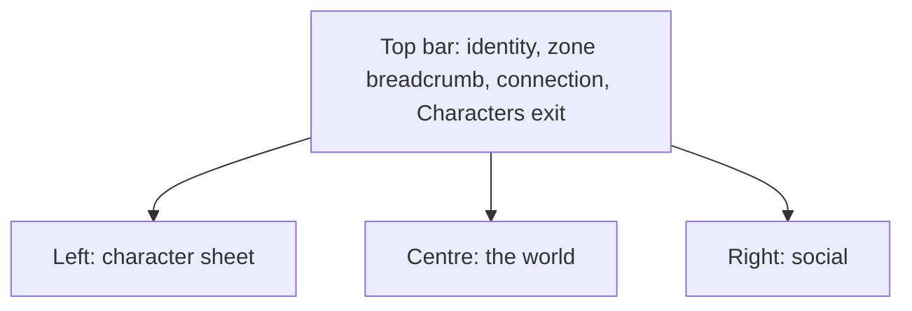

# Client UI architecture

> **Audience:** designers laying out game surfaces and developers implementing them.
> **What this is:** the shape of the game screen, every surface on it, what opens where, and the two
> structural decisions that constrain all of it.
> **Veldrath is web-first.** The SvelteKit app in `web/` is the only client; the retired desktop
> client and its editor are recorded in the [design system §10](design-system.md#10-history--retired-surfaces).
> **Related:** [Design system](design-system.md) for tokens and component primitives ·
> [Asset specs](design/asset-specs.md) for imagery ·
> [Foundry map editor](https://git.kungraseri.cloud/Veldrath/Veldrath/src/branch/main/plans/foundry-map-editor.md)
> for authoring.

---

## 1. The shell

The game is a fixed three-column grid defined once as `.game-shell` in `brand.css`. There are no tabs
in the centre and no full-height drawers. Each column owns one job, and anything that used to be
duplicated between a header, a footer and a side panel now lives in exactly one place.

| Column | Owns | Component |
|---|---|---|
| **Top bar** | Character identity, zone and location breadcrumb, connection state, the Characters exit | `GameHeader.svelte` |
| **Left** | The character sheet: health and mana bars, gold and XP, the eight-slot equipment rack, the bag list with per-item actions, and the character menu | `LeftSidebar.svelte` |
| **Centre** | The world only: the map graph, the selected or current node with its travel action, the "Local" block (enemies present, Search, Rest, Merchant, Leave zone), the ground-items block and the "Discovered" block. Combat **replaces** the Local block while a fight is live | `GameScreen.svelte` |
| **Right** | Social only: chat channels, log and composer, plus the "Also here" occupant list | `RightSidebar.svelte` |

### 1.1 Grid and breakpoints

| Viewport | Columns |
|---|---|
| > 1200px | `minmax(220px, 260px)` · `1fr` · `minmax(280px, 340px)` |
| 900–1200px | Left + centre; **the social column is hidden** |
| < 900px | Single column, all three stacked |

The middle breakpoint is a deliberate loss: below 1200px the player keeps the character sheet and the
world, and social is the column that goes. Any new social feature must therefore also survive being
unavailable on a laptop.

### 1.2 What lives where

- **Inventory is the bag.** Equipped items stay in the bag list, flagged with an `Equipped` badge and
  shown in the rack. There is no separate inventory panel to open.
- **Secondary surfaces are centred dialogs**, never slide-overs. See [§3](#3-the-dialog-set).
- **The world column is the only place state changes destination.** Travel, search, rest, fight and
  leave all happen there; the sidebars read and act on the character, not on the world.
- **Nothing is duplicated.** The connection dot lives in the top bar, not in a footer; map and occupant
  counts live in their own blocks, not in a status strip.

---

## 2. Surface inventory

Every surface a player can see, what puts it on screen, and the states it must define.

| Surface | Type | Entry point | Contains | States to design |
|---|---|---|---|---|
| Landing / hero | Public page | `/` | Crest behind the hero at 18% opacity, kicker, heading, three CTAs, feature cards | default, signed-in |
| Auth card | Public page | `/login`, `/register`, `/forgot-password`, `/reset-password`, `/verify-email` | Crest above the form, OAuth providers, divider, inline error band, success band | default, submitting, error, success |
| Character roster | Signed-in page | `/characters` | Character cards with crest, name, level, last session; create and enter actions | empty roster, at-capacity, deleted |
| Character creation | Signed-in wizard | `/characters/new` | Seven steps, point-buy attributes, species/class/background choices | step progress, invalid input, server error |
| Top bar | Panel | Game shell | Identity, breadcrumb, connection dot, Characters exit | online, reconnecting, offline |
| Character sheet | Panel | Game shell | Bars, gold/XP, equipment rack, bag | full bag, empty bag, no equipment, dead |
| Equipment slot | Cell | Character sheet | Type glyph + item name, or dashed empty slot | filled, empty, hover, focus |
| Bag row | Row | Character sheet | Name (rarity), status line, icon-only actions | equipped, un-equipped, merchant-only actions, discard confirm |
| Item tooltip | Overlay | Hover or focus on a bag row or slot | Rarity name, type/slot, description, stats, requirements | met, unmet, equipped |
| Map graph | Panel | Centre column | Cardinal nodes, connectors, current node, travel targets | undiscovered, blocked, current |
| Node detail | Block | Centre column | Zone/location detail and the travel action | reachable, unreachable |
| Local block | Block | Centre column | Enemies present, Search, Rest, Merchant, Leave zone | no enemies, in combat, in a shop zone |
| Combat panel | Block, replaces Local | Centre column | Participants, actions, log | player turn, enemy turn, victory, defeat |
| Ground items | Block | Centre column | Items dropped in the location, pick up | empty |
| Discovered block | Block | Centre column | Results of an area search | nothing found |
| Quest tracker | HUD widget | Game shell | Tracked quest and objectives | none tracked, objective complete |
| Chat | Panel | Right column | Channels, log, composer | empty, new message, whisper/global/system tints |
| Also here | Panel | Right column | Occupants in the location | alone, party members present |
| Dungeon panel | Panel | Centre column | Lobby, rooms, progress | not in a dungeon, cleared |
| Quest log dialog | Dialog | Character menu | Tracked and available quests, accept, abandon, turn in | empty, objectives incomplete |
| Shop dialog | Dialog | Character menu at a merchant, or Local | Stock, buy, sell | empty stock, not enough gold |
| Attributes dialog | Dialog | Attribute strip | Point allocation | no points, all spent |
| Item details dialog | Dialog | Click a bag row or item | Full item card | requirements unmet |
| Party dialog | Dialog | Character menu | Members, invite, leave, kick | solo, full party, pending invite |
| Abilities dialog | Dialog | Character menu | Powers usable out of combat | none unlocked, on cooldown |
| Skills dialog | Dialog | Character menu | Skill sheet and ranks | none trained |
| Crafting dialog | Dialog | Character menu | Recipes, ingredients, craft | missing materials, no station |
| Conversation dialog | Dialog | Talk in the People block | Speaker prose, choices, and what each choice changes | nothing authored, every choice blocked |
| Settings dialog | Dialog | Character menu | Preferences | — |

**Every surface above needs four states designed, not one:** *empty* (nothing to show, and what the
player should do next), *loading* (the first payload has not arrived), *error* (the request failed, and
the retry), and *populated*. The empty state is the one most often skipped and the one players see
first.

---

## 3. The dialog set

Secondary surfaces are centred dialogs built on Bits UI `Dialog` with two primitives in `brand.css`:
`.game-dialog-backdrop` and `.game-dialog`.

| Dialog | Opened by | Lives in |
|---|---|---|
| Quest log | Character menu | `GameOverlays.svelte` |
| Shop | Character menu at a merchant, or the Local block | `GameOverlays.svelte` |
| Attributes | The attribute strip in the character sheet | `GameOverlays.svelte` |
| Item details | Clicking a bag row or equipment slot | `GameOverlays.svelte` |
| Party | Character menu | `GameOverlays.svelte` |
| Settings | Character menu | `GameOverlays.svelte` |
| Abilities | Character menu | `PowersOverlay.svelte` |
| Skills | Character menu | `SkillsOverlay.svelte` |
| Crafting | Character menu | `CraftingOverlay.svelte` |
| Conversation | The Talk button in the People block | `DialogueOverlay.svelte` |

**Rules**

- One scroll container per dialog. The shell behind never scrolls.
- Width is `min(40rem, 100vw - 2rem)`, height `min(80vh, 44rem)` — a dialog is a card, not a page.
- Header pattern: gold glyph, title in Cinzel 16px, close control on the right. The item-details dialog
  is the exception: its title takes the **rarity colour**, because the name is the primary information.
- Destructive actions are never adjacent to the primary action, always tonal-error, and always
  two-step where the loss is permanent.
- A dialog never opens another dialog. The character menu is the single launcher.

---

## 4. Gameplay surfaces and their wire

Everything below rides on the same `GameSession` runes store; no panel keeps its own copy of state.

| Surface | Where | Wire |
|---|---|---|
| Bag actions | Character sheet rows — name line, status line, icon-only actions | `EquipItem` (slot derived server-side), `UseItem`, `SellItem`, `DropItem`, `DropItemToGround` |
| Item details | Tooltip beside the row, plus the centred dialog | `InventoryLoaded` → `InventoryItemView` |
| Attributes | Dialog behind the attribute strip | `AllocateAttributePoints` → `AttributePointsAllocated` |
| Abilities | Character menu → Abilities | `UseAbility` |
| Ground items | Centre column | `GetGroundItems`, `DropItemToGround`, `PickUpGroundItem` → `GroundItemsChanged` |
| Quest log | Character menu → Quest log | `GetQuestLog`, `AcceptQuest`, `AbandonQuest`, `TurnInQuest` → `QuestLogReceived`, `QuestTurnedIn` |
| Area search | Centre column, "Discovered" block | `SearchArea` → `AreaSearched` |

**Bag rows are three lines.** The name leads in its rarity colour, with a small muted gold glyph beside
it; the status line carries the equipped badge and rarity/type/slot/durability; the actions are
icon-only on their own line. Hover or focus opens the tooltip, which flips sides and clamps to the
viewport so it stays readable from the narrow left column.

**Why the client shows a flat item view.** `InventoryItemView` carries `Rarity` and `Type` as
**strings** (`"Rare"`, `"Weapon"`), not enums: the raw item graph serialises enums as numbers over
SignalR, which is how the UI once rendered `rarity: 2` and lost every rarity colour. `Slot` is resolved
server-side from the item type — the client never guesses a slot.

---

## 5. Decision: panel-driven UI, not 2D map rendering

**Decision:** the game is presented through **panels** — structured text, tables and clickable lists —
not a rendered tilemap or sprite scene.

- Movement and interaction are point-and-click: click an exit to travel, click an entity to interact,
  click a node on the map graph to move.
- The tile and map **data model stays**: zone tiles, region maps, collision masks, fog masks, exit tiles
  and entity positions are still delivered by the server and still drive the UI. They are projected
  into lists and cards rather than drawn as a grid.
- All renderer abstractions — sprite and ASCII renderers, tile texture caches, tile registries,
  `RendererMode` — were removed with the desktop client and must not be reintroduced.

**Consequences**

- One UI concept per panel: zone detail, region overview, character, chat, combat, inventory, shop,
  journal, attribute allocation.
- `GameSession` is the single orchestrator: it applies hub payloads to Svelte runes and exposes
  commands; components only bind and forward input.
- **Illustration is decoration, not gameplay.** There is no sprite pipeline, so art is used for
  identity and atmosphere — crest, emblems, empty states — not for representing entities in the world.
  See the [asset specs](design/asset-specs.md).

---

## 6. Decision: one DB-backed map graph for world navigation

**Decision:** world navigation is a single graph stored in Postgres (`Map`, `MapNode`, `MapEdge`), read
by the game client and authored through the server's content endpoints.

- **Nodes** carry zone and location identity, position hints and discovery state; **edges** carry the
  connection type. The graph arrives as `MapGraphReceived` / `NodeTraveled` payloads.
- **Layout is cardinal** — orthogonal connectors in layered columns — implemented in
  `web/client/src/lib/game/cardinal-layout.ts`. There is no diagonal connector style, because a
  diagonal pair has no inferable direction in the data model.
- **Validation lives with the data:** `MapGraphValidator` rejects dangling edges, duplicate node ids and
  unreachable nodes.
- **Authoring** happens through the server write path, not by hand-editing JSON. Tilemap/TMX authoring
  was removed; do not add tile coordinates back into the map model.

**Consequences**

- Adding a location is a data change — a node plus edges — never a client code change.
- A layout change must keep the `cardinal-layout` unit tests green.
- The graph is drawn from HTML and CSS (`.map-node-cell`, `.map-connector-*`), so its visual language is
  tokens and borders, not an image.

---

## 7. The Foundry map editor and the review gate

The map graph is authored in Foundry — not in a desktop tool and not in the seeder. Since milestone G
the editor is a canvas plus an inspector, and nothing an author does can put a map in front of a player.

**One draft, one writer.** `/maps/[mapId]` holds a single `MapGraphDto` in component state. The canvas,
the metadata form and the inspector all mutate that object; save and validate post it whole in a hidden
field. `parseDraftGraph` refuses anything that is not this map's graph and falls back to the stored
copy, so a mangled payload is a no-op rather than a partial write.

**The rules live in TypeScript modules, not in markup.** `map-canvas.ts` (positions, unplaced lane,
collision, tidy layout), `map-edges.ts` (direction inference, self-reference and duplicate-direction
refusals, reciprocal edges) and `map-nodes.ts` (suggested ids, node defaults, delete refusals) are pure
and unit tested; components render and dispatch. Two rules matter:

- A node with no authored `layoutX`/`layoutY` is **never** given one silently. It sits in an "unplaced"
  lane, because the difference between "the author put it there" and "the layout did" is the difference
  between data and a guess.
- Blocks are *prevented* in the gesture that would create them — a diagonal pair has no inferable
  direction, a second edge in the same direction is refused while drawing, deleting a two-way connection
  removes both directions — because each is a validator error that is cheaper to prevent than to read
  after a save.

**References are pickers.** `GET /api/content/maps/targets` serves every map, zone and interior owner,
zone location, region owner and node. A picker cannot produce the typo the world validator exists to
catch.

**The lifecycle is the gate.** A map is `Draft` → `In review` → `Live`, with `Changed since approval`
derived from `ApprovedVersion < Version`:

| State | `IsActive` | Set by | Visible to players |
|---|---|---|---|
| Draft | `false` | `POST /api/content/maps` | no |
| In review | `false` | `POST /{id}/submit` | no |
| Live | `true` | `POST /{id}/review` (`Curator`) | yes |
| Changed since approval | `true` | an edit after approval | yes, while the edit awaits re-review |

`Apply` deliberately does not write `IsActive`: only review and deactivate change it, so a crafted save
payload cannot activate a draft. Approval requires a submission and a clean world validate; rejection
clears the submission and leaves the draft editable with the reviewer's notes (`LastReviewNotes`) on the
map. Live maps are retired by deactivating — refused while another map's node still exits there — and
only drafts can be deleted.

**Access follows the author/reviewer split.** Reads need a session and nothing more (the graph carries
hidden nodes and unlock keys, so it is never anonymous); authoring is the author's own work, with
`content.manage` able to write any; review and deactivation need `content.review`, never a role. Drafts
are scoped per caller, and `canEdit` on the DTOs is what the editor disables its controls with.

A reviewer deciding on a map is deciding to publish it, so the review queue runs the world validator
over each submitted graph first and says whether approval would accept or refuse it — including the one
warning approval refuses, `map_without_exit`. Decisions are audited and the author is told in the inbox
they already use: rejections carry the notes, and a retirement says the map left the game.

---

## 8. Adding a surface

1. **It is a panel or a dialog.** Panels own a job in one column; dialogs are launched from the
   character menu or from the object they act on. Slide-overs and tabs in the centre column are not an
   option.
2. **One concept per surface.** If it needs a second scroll region, it is two surfaces.
3. **State lives in `GameSession`.** A component that keeps its own copy of game state will disagree
   with the server within one event.
4. **Design the four states** from [§2](#2-surface-inventory), including the empty one.
5. **Use the primitives.** `.game-panel`, `.game-panel-header`, `.bag-row`, `.equip-slot`,
   `.game-dialog`, `.rarity-*` and the Skeleton presets already exist; a new visual vocabulary is a
   design-system change, not a component change.
6. **No raw colour, no new radius, no new spacing value** — see the
   [design system](design-system.md#8-implementation-notes).

---

## Related

- [Design system](design-system.md) — tokens, typography, component primitives and the retired-surface rule.
- [Brand guide](design/brand-guide.md) — the mark and the art direction the game's imagery follows.
- [Asset specs](design/asset-specs.md) — canvas sizes and export rules for anything the shell displays.
- [`plans/ui-depth.md`](https://git.kungraseri.cloud/Veldrath/Veldrath/src/branch/main/plans/ui-depth.md) — which of these surfaces are wired, stub or absent.
- [`.github/agent-memory/veldrath-memory.md`](https://git.kungraseri.cloud/Veldrath/Veldrath/src/branch/main/.github/agent-memory/veldrath-memory.md) — session-by-session notes on the pivots.
