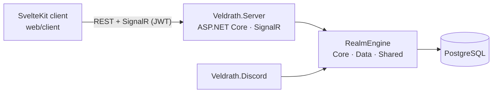

# Veldrath

Veldrath is a web-first fantasy roleplaying platform: a SvelteKit client, an ASP.NET Core game
server with SignalR, and a .NET world engine behind them.

## Players

- [Lore and the Calethic language](docs/lore/calethic-language.md) — the language of the world:
  phonology, naming conventions, and the vocabulary used across its regions and factions.

## Building on Veldrath

- [Web client](docs/client-overview.md) — how the SvelteKit client is structured, how accounts and
  game tokens work, and how it talks to the server.
- [API reference](api/index.md) — the engine, the game server and the Discord bot, generated from
  their XML doc comments.
