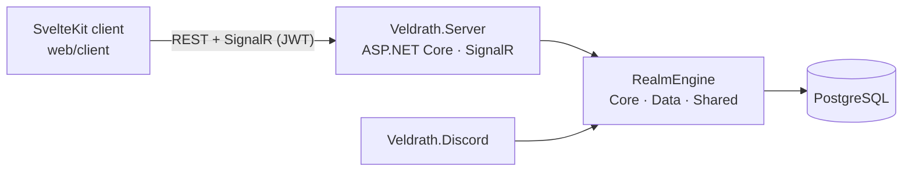

# Veldrath

Veldrath is a web-first fantasy roleplaying platform: a SvelteKit client, an ASP.NET Core game
server with SignalR, and a .NET world engine behind them.

## Start here

| Area | Where to go |
| --- | --- |
| **The client** | [Client overview](docs/client-overview.md) — workspaces, routes, auth, and the game shell |
| **Design system** | [Design system](docs/design-system.md) — Crimson Seal / Emberfall / Gold tokens, typography, components |
| **UI decisions** | [Client UI architecture](docs/client-ui-architecture.md) — panel-driven UI and the DB map graph |
| **Deployment** | [Deployment](docs/deployment.md) and the [Coolify reference](docs/coolify-deployment.md) |
| **Contributing** | [CI and releases on Forgejo](docs/ci-forgejo.md) |
| **API reference** | [Generated reference](api/index.md) from the XML doc comments |
