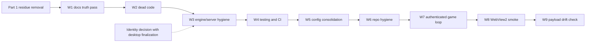

# Blazor Decommission + Whole-Codebase Cleanup

> **Status:** Done — web-first, desktop client retired
> **Date:** 2026-10-24 (updated 2026-10-25)
> **Scope:** finish the Blazor → SvelteKit transition, audit the repository for cleanup, and retire the
> Avalonia desktop client so the SvelteKit app is the only client.
> **Related:** [`sveltekit-migration.md`](sveltekit-migration.md), [`../docs/client-ui-architecture.md`](../docs/client-ui-architecture.md)

---

## 1. Where the migration actually stands

Phase 6 already deleted the Blazor applications. Verified in the current tree:

- gone: `Veldrath.Web`, `RealmFoundry`, `Veldrath.Auth.Blazor`, `Veldrath.GameClient.Components` (and their test projects, `.slnx` files, CI workflow, MudBlazor/bunit packages);
- the desktop host is now `DesktopUiServer`, which serves the static Svelte build and proxies `/api` + `/hubs` with an injected JWT;
- the only surviving `Blazor`/`MudBlazor` code in the repo lives in an orphan folder: `scripts/dev/blazor/`.

So the remaining work is **residue removal (no behaviour risk)** plus **one real architectural decision** (ASP.NET Core Identity), not a migration.

---

## 2. Part 1 — Blazor residue removal

| Artifact | Detail | Action |
|---|---|---|
| `scripts/dev/blazor/` | 19 orphan files: 18 `.razor` snapshots of deleted pages plus `VeldrathTheme.cs` (MudBlazor theme) and 5 CSS copies. Nothing references the folder. | Delete. Git history keeps it. |
| `Veldrath.Client.csproj:47` | Comment `Embedded WebView2 for Blazor game UI hosting` | Reword to "hosts the Svelte desktop build". |
| [`RealmForge/README.md`](../RealmForge/README.md) | Claims `.NET MAUI Blazor Hybrid` / "Why Blazor Hybrid?" — the app is Avalonia + ReactiveUI. | Rewrite (tech stack, run commands, what it edits). |
| [`docs/design-system.md`](../docs/design-system.md) | MudBlazor-only content: §5.5 spacing delegation, MudBlazor token map in §8.2, RealmFoundry tables (§3.1, §7.8), §8.3, §8.4, §8.5 migration notes. | Move to a single appendix "Retired surfaces (Blazor/MudBlazor)" at the end; keep Avalonia + SvelteKit sections as the live reference. |
| [`web/shared/db/README.md`](../web/shared/db/README.md:41) | Section "Why this is safe on the existing Blazor database" | Reword to "the existing Postgres database". |
| `wiki/` (submodule) | `Foundry-Overview.md` describes a Blazor Server app; `Home.md`, `_Sidebar.md`, `Engine-Implementation-Status.md` list RealmFoundry / `Veldrath.Auth.Blazor` / Caddy. | Rewrite `Foundry-Overview.md` as the `/foundry` route group doc, fix Home/Sidebar/Implementation-Status. Separate commit inside the submodule. |
| `plans/` (23 files) | Historical designs: the 19 Blazor-era plans, the two superseded rendering plans, `reactive-ui-pivot-plan`, and `sveltekit-phase0`. | **Delete them.** First extract what is still true: the panel-driven UI and map-graph decisions moved to [`docs/client-ui-architecture.md`](../docs/client-ui-architecture.md); everything else is already covered by `docs/` and the agent memory. `plans/` keeps only `blazor-decommission-and-cleanup.md`, `sveltekit-migration.md`, and a short `README.md`. |
| [`docs/deployment.md`](../docs/deployment.md:180) | "The old Blazor `Veldrath.Web` and `RealmFoundry` containers … are retired." | Keep — accurate history. |

Acceptance: `grep -ril "blazor\|mudblazor"` (excluding `node_modules`, `bin`, `obj`, `.vs`, `web/llms`, build output) returns only intended mentions: the design-system appendix, the deployment history note, agent-memory session logs, and historical port comments.

---

## 3. Part 2 — The one real decision: ASP.NET Core Identity

> **Resolved (2026-10-25): Option 2.** With the desktop client gone, the Identity *auth surface* was
> deleted and the Identity *tables* were kept as the server-owned RBAC store. Better Auth owns
> registration, sign-in, OAuth, password reset, and email confirmation; the server validates the game
> JWTs it mints, provisions the `AspNetUsers` row just in time (`JwtClaimsEnrichment` →
> `AccountProvisioningService`), and answers RBAC claims from `AspNetUserRoles` /
> `RolePermissionResolver`. Option 3 (removing Identity entirely) remains a separate future project.

Identity (not Blazor) is what still ties the old world to the new one:

- `PlayerAccount : IdentityUser<Guid>` is the game account row (characters, RBAC, moderation, bans).
- `/api/auth/{register,login,refresh,renew-jwt,logout,exchange,external/*,session}` existed for the desktop client's native sign-in — **deleted** with W12.
- `InternalAccountBridgeEndpoints` + `foundry-bridge.ts` + the `hooks.server.ts` sync mirrored Better Auth accounts into Identity; deleted with the client.

| Option | What changes | Cost / risk | When it makes sense |
|---|---|---|---|
| **1. Keep Identity as the account store (recommended)** | No deletion. Optionally shrink the bridge to one-way JIT provisioning and drop the password mirror once the desktop signs in through the web. | None now | Immediately — unblocks shipping, keeps desktop native sign-in working |
| **2. Retire Identity *auth* endpoints, keep Identity *tables* | Delete `/api/auth/{login,register,refresh,renew-jwt,external/*,session}` and `AuthService` token issuance; desktop signs in via Better Auth (browser/deep-link + exchange code). Identity tables stay for RBAC/characters. | Medium: needs desktop auth UX + deep-link handling; touches `AuthEndpoints`, `ExternalAuthEndpoints`, `SessionEndpoints`, `Veldrath.Auth` | After the desktop shell decision (full-window Svelte or native chrome) |
| **3. Remove Identity entirely** | `PlayerAccount` becomes a plain entity; roles/permissions move to first-class tables; password migration for remaining Identity-only accounts; drop cookies, DataProtection keys, `AspNetUserLogins`, `Identity` stores. | Large: schema + migration + every `UserManager`/`RoleManager` call site | Only after 2 has been live for a while |

Recommendation: **Option 1 now, decide 2 together with the desktop finalization**, and treat 3 as a separate future project. Nothing in Part 1 depends on it.

---

## 4. Part 3 — Whole-codebase cleanup workstreams

Ordered by risk/return. Each item is a single reviewable PR.

### W1 — Documentation truth pass (low risk, high value)
- Reconcile [`AGENTS.md`](../AGENTS.md), [`README.md`](../README.md), [`web/README.md`](../web/README.md), [`web/client/README.md`](../web/client/README.md), `wiki/`, `docs/design-system.md` with the current tree (ports 8080/8081/8083, `#lib`, `$app/env`, `#lib/server/env.ts`, no Caddy, no compose in Coolify).
- Add `plans/README.md`: index every plan with `active` / `superseded` / `archived` + one-line purpose. This alone stops future agents from following dead designs.
- Make `docs/coolify-deployment.md` the single deployment reference; `docs/deployment.md` becomes the overview that links to it.

### W2 — Dead code and unused references
- `Veldrath.Contracts`: enumerate consumers (client/server/tests) and delete DTOs no endpoint returns.
- `Veldrath.GameClient.Core`: now desktop-only — confirm no server/web references, then decide whether `IGameApiClient` (unimplemented in .NET now?) is still needed.
- `Veldrath.Auth`: confirm the desktop-only surface.
- Duplicate payload definitions: `Veldrath.GameClient.Core/Payloads/*` vs `web/client/src/lib/game/types.ts` — document the two-runner split or generate the TS types from the C# records with a small script.
- `[Obsolete] StartingSpellIds` in [`CharacterClass`](../RealmEngine.Shared/Models/CharacterClass.cs:137): remove or migrate usages.
- Web server duplication: every module that hand-rolls `fetch` should go through `#lib/server/game-request.ts` (`game-api.ts` already does; check `editorial-api.ts`, `content-api.ts`, `admin-api.ts`, `foundry-api.ts`, `character-api.ts`).

### W3 — Engine/server hygiene
- XML doc gaps flagged as P4 in [`.github/agent-memory/engine-codebase.md`](../.github/agent-memory/engine-codebase.md) — close them or move to "won't fix".
- Review `RealmEngine.Core` handler quirks listed in the memory file and either fix or document at the call site.
- ✅ CORS extracted to [`Infrastructure/CorsSetup.cs`](../Veldrath.Server/Infrastructure/CorsSetup.cs) and
  Identity + JWT bearer + authorization policies + OAuth providers extracted to
  [`Infrastructure/AuthSetup.cs`](../Veldrath.Server/Infrastructure/AuthSetup.cs). `Program.cs` went
  from 703 to 520 lines and the dead `using` directives went with the code. Pure refactor — 788 server
  tests still pass. The rate limiter and health checks are the remaining inline blocks if this
  continues.
- ✅ `[Obsolete] StartingSpellIds` on `CharacterClass` deleted: it had no readers anywhere in the
  tree (only `StartingPowerIds` is used), and JSON payloads that still carry
  `startingSpellIds` are ignored on deserialize.

### W4 — Testing and CI
- ✅ `FakeXxx` stub audit — every stub class (`FakeAuthService`, `FakeHttpHandler`, `FakeGameStateService`,
  `FakeHubConnection`, …) is consumed by its own project's tests; nothing was dead, so no consolidation
  was needed. New tests still follow the `FakeXxx` convention instead of a mocking framework.
- ✅ Coverage visibility: [`codecov.yml`](../codecov.yml) now declares one flag per component
  (`engine`, `server`, `client`, `forge`, `discord`, `web`) plus project/patch statuses. They are
  `informational: true` on purpose — flip them to blocking once the numbers have been stable.
- ✅ Markdown link check: [`scripts/check-markdown-links.mjs`](../scripts/check-markdown-links.mjs) +
  [`.github/workflows/repo-hygiene.yml`](../.github/workflows/repo-hygiene.yml). Offline by design (no
  external URL checks), understands the repository's `path:line` link form, and skips `web/llms/` and
  the `wiki/` submodule. It found **18** broken relative links on the first run — dead Blazor paths in
  the memory files, `docs/API_SPECIFICATION.md`, `theme.css`/`layout.css`, and two deleted plans — all
  fixed.
- ✅ `dotnet format --verify-no-changes` **now gated** (see W13): the repo-wide pass landed as its own
  commit, the rules are pinned in the root [`.editorconfig`](../.editorconfig), and
  [`format.yml`](../.github/workflows/format.yml) enforces them.
- ✅ Web: Playwright covers the authenticated `/characters` → `/play` path via W7's `game-loop.e2e.ts`.

### W5 — Configuration and deploy consolidation
- One source of truth for public URLs/ports: `docker-compose*.yml`, `.env.example`, `web/client/.env.example`, and the two deploy docs (now consistent after the env audit — verify with a scripted cross-check).
- ✅ `docker-compose.api.yml` and `docker-compose.debugging.yml` deleted. Both were strict subsets of
  `docker-compose.dev.yml` (postgres + server, plus discord in the debugging one), predated the web
  app, and nothing referenced them — not the docs, not the scripts, not the skills. `docker compose -f
  docker-compose.dev.yml up postgres server` covers the same need.
- Add a `scripts/check-env-docs.mjs`-style guard that fails CI when a documented env var is not read by code (or vice versa).
- ✅ Done: the SSH deploy path (`deploy.yml` + three `if: false` deploy jobs) is gone; Actions publishes images and Coolify deploys.

### W6 — Repository hygiene
- ✅ Remove `scripts/dev/blazor/` (Part 1) and any other orphan scratch folders.
- ✅ Re-check `.gitignore` / `.dockerignore` after the file moves (`client/build-desktop`, `SvelteApp/`, `.env`).
- ✅ `web/llms/` **stays in-repo.** 16 files, 6.4 MB, one-time clone cost; it is the offline reference
  corpus the `web-development` / `web-ui` skills and agent sessions read, and moving it to a release
  artifact would add a network dependency plus a version pin for no real gain. `web/llms/README.md`
  already records provenance and the refresh procedure.

### W7 — Authenticated browser coverage of the game loop
Moved here from migration Phase 2: only the unauthenticated guards run in CI today, so the
roster → play → travel → chat → inventory path has nothing above reducer-unit coverage.

- Add `web/client/tests/game-loop.e2e.ts`: sign up, create a character through the
  `/characters/new` wizard, assert `/play/:id` renders the zone, travel to a node via the map,
  then open the inventory.
- **A real API is required, not a mock.** SSR calls `/api/characters` from the SvelteKit server
  process (browser-level `page.route` cannot intercept it) and SignalR needs a live hub, so the
  job must boot `Veldrath.Server`.
- `ci-web.yml`: new `e2e-game` job — Postgres service + `dotnet run --project Veldrath.Server`
  with `ConnectionStrings__DefaultConnection`, `Jwt__Key`, `Web__BaseUrl=http://localhost:4173`,
  `Cors__AllowedOrigins__0=http://localhost:4173`, `INTERNAL_BRIDGE_TOKEN`; wait on `/health`,
  then run the game spec.
- Gate the spec behind `E2E_GAME=1` so plain `npm run test` stays server-free for local runs.
- Exit criteria: the job fails if roster load, zone entry, node travel, or the inventory break.

### W8 — Desktop bundle / WebView2 smoke
Moved here from migration Phase 5. **Decision:** assert the bundle the WebView2 shell actually
serves instead of driving the native control — the test host has no renderer, and a real render
probe is flaky on the Windows runner.

- `Veldrath.Client.Tests/HostedWeb/DesktopBundleSmokeTests.cs` (`[Trait("Category", "Bundle")]`)
  starts `DesktopUiServer` against the real `web/client/build-desktop` and asserts the SPA shell, a
  hashed `/_app/immutable/` asset, the `/desktop` SPA fallback, `/health`, and that
  `WebView2Loader.dll` ships next to the executable.
- `ci-client.yml` already runs `npm run build:desktop` before `dotnet test`, so this gate is live on
  the Windows runner; locally the tests no-op when the bundle is absent.
- **Open (optional):** an actual WebView2 render probe. The shell is only a host for the Svelte
  bundle, so the bundle assertion covers the real regression risk.

### W9 — Payload contract drift
`Veldrath.GameClient.Core/Payloads/*.cs` and `web/client/src/lib/game/types.ts` are hand-mirrored;
a field rename can silently break the web client.

- `web/client/src/lib/game/payload-contract.test.ts` parses every C# positional record (PascalCase)
  and every TS interface (camelCase) and fails when a mirrored payload's property sets diverge. It
  also asserts the payloads the game shell consumes have a TS counterpart.
- **The wire is the source of truth,** not either mirror: the anonymous objects in
  `Veldrath.Server/Hubs/GameHub.cs` are what actually reaches clients. When a mismatch turns up,
  check GameHub first, then fix both mirrors in the same PR.
- Full OpenAPI → TypeScript generation stays deferred; this is the cheap guard.

### W11 — Retire the desktop client (2026-10-25)

**Decision:** Veldrath is **web-first and only**. Cross-platform playability is satisfied by the
browser; a second, native client would have to be rebuilt on a cross-platform webview (Tauri/Electron)
or ported to Avalonia XAML, and neither is worth maintaining two UI implementations. Revisit only if a
desktop-specific capability (offline play, native audio, Steam integration) becomes a requirement.

Deleted:

- `Veldrath.Client/` (Avalonia shell: `GameWebView`, `DesktopUiServer`, `GameViewModel`,
  `NativeBridgeService`, LibVLC audio), `Veldrath.Client.Tests/` (681 tests).
- `Veldrath.GameClient.Core/` + tests (desktop-only payload records and hub services).
- `Veldrath.Auth/` + tests (a 2-file client auth wrapper with no other consumer).
- `Veldrath.Client.slnx`, `Veldrath.slnx`, `versions/client.props`, `.github/workflows/ci-client.yml`,
  the `client/v*` release path, the `client` Codecov flag, and the `run-client` skill.
- Web: the `/desktop` route, `#lib/desktop/api.ts`, the `build:desktop` scripts, `adapter-static`, and
  `GameHubOptions` (the hub is always `PUBLIC_HUB_URL` with `/api/game-token`).
- Server: the Avalonia-only `Items`/`Equipped` projections on `InventoryLoaded` and `Items` on
  `ShopCatalog`.

Consequences worth remembering:

- **Better Auth is the single source of truth for authentication**, and the account bridge is gone:
  `InternalAccountBridgeEndpoints`, `foundry-bridge.ts`, both `/api/foundry-bridge/*` routes, and the
  sync calls in `hooks.server.ts`, `/register`, and `/account` were deleted. Accounts are provisioned
  just in time from Better Auth claims (`JwtClaimsEnrichment`), which is also where RBAC comes from.
- **The email half of the bridge is kept deliberately.** The .NET server owns the SMTP configuration
  and templates; [`email.ts`](../web/client/src/lib/server/email.ts) relays verification and
  password-reset messages to `InternalEmailEndpoints`, so `INTERNAL_BRIDGE_URL` /
  `INTERNAL_BRIDGE_TOKEN` remain. Moving mail into the web app was tried and reverted: it costs a
  second SMTP config and a duplicate mailer for no functional gain.
- **The payload guard now compares the wire, not a C# mirror.** `payload-contract.test.ts` parses
  `GameHub.cs` directly and unions the shapes of multi-variant events (`CombatTurn`), so it catches
  drift that the deleted `Veldrath.GameClient.Core` records used to hide.
- JWT audience is still the legacy string `Veldrath.Client` across server/web/compose. Rename it to
  something meaningful only as a coordinated change to both Coolify resources.

### W10 — Desktop release packaging (superseded by W11)
The published desktop clients shipped **without the Svelte UI**: `Veldrath.Client.csproj` only bundles
`web/client/build-desktop/**` when `index.html` already exists, and the `publish` job in
`ci-client.yml` is a separate job from the one that runs `npm run build:desktop` — fresh checkout, no
Node. `DesktopUiServer.ResolveUiPath()` then found nothing and the WebView panel stayed empty.

- ✅ `ci-client.yml` publish job now sets up Node, runs `npm ci --allow-git=all` +
  `npm run build:desktop`, and has a `Verify every published client ships the UI bundle` step that
  fails the release when `SvelteApp/index.html` or `WebView2Loader.dll` is missing from any of the four
  published folders.
- ✅ `Veldrath.Client.csproj` gained an `EnsureDesktopUiBundle` target: `dotnet publish` fails with
  `VD0001` when the bundle is absent, instead of silently producing a UI-less app.
  `-p:SkipDesktopUiBundleCheck=true` is the deliberate escape hatch. Builds and tests are unaffected.
- ✅ `run-client` skill documents the `npm run build:desktop` step.
- Still open (product decisions, not code): macOS/Linux builds only get the native text-map fallback
  because `GameWebView` is WebView2/Windows-only; the WebView2 Evergreen runtime needs
  detection/bootstrapping on clean Windows machines; `appsettings.json` still defaults to
  `localhost:9000`/`localhost:8081` for `ServerBaseUrl`/`FoundryBaseUrl`.

---

## 5. Sequencing

**Acceptance for the whole effort**
1. `rg -i blazor` outside `plans/`, `web/llms/`, and the design-system appendix finds nothing.
2. `dotnet build Realm.Full.slnx`, the 7 .NET test projects, and `cd web && npm run typecheck && npm run lint && npm run test && npm run build` all pass after every PR.
3. `plans/` contains only live plans plus a short `README.md`; no document references a deleted project or plan.
4. No documentation tells a reader to run a command that no longer exists.

---

## 6. Progress log

| Step | Status | Commit |
|---|---|---|
| Part 1 — residue removal, plan pruning, design-system appendix, wiki, READMEs | ✅ Done | `33ac36ab`, `ebc70430` |
| W1 — documentation truth pass (AGENTS/README/CONTRIBUTING, dangling skill + instruction links) | ✅ Done | `ebc70430` |
| W2 — dead code (contracts audit, `editorial-api` → `gameApiFetch`) | ✅ Done | `5684f0d9` |
| W3 — engine/server hygiene | ✅ Done: CORS extracted to `Infrastructure/CorsSetup.cs`, Identity/JWT/authorization/OAuth extracted to `Infrastructure/AuthSetup.cs` (`Program.cs` 703 → 520 lines, 788 server tests green), the unused `[Obsolete] StartingSpellIds` deleted, and the P4 XML-doc list closed (already fully documented; CS1591 enforces it). Optional leftover: the rate limiter and health-check blocks. | `456ad367` + tail commits |
| W4 — testing/CI (stub consolidation, coverage floors) | ✅ Done: stub audit found no dead fakes; `codecov.yml` adds per-component flags with informational statuses; `scripts/check-markdown-links.mjs` + `repo-hygiene.yml` gate documentation links (18 broken links fixed). The `dotnet format` gate was deferred here and landed in W13. | W4 commit |
| W5 — config consolidation | ✅ Done: obsolete SSH deploy path removed (`deploy.yml` + the three `if: false` deploy jobs), `docs.yml` now watches `**/*.cs` instead of a hand-maintained project list, engine CI moved to `ubuntu-latest`, Dependabot gained a `/web` Dockerfile entry, and the two redundant compose files were deleted. The env-var documentation cross-check script is the one optional leftover. | `9b890ef8` + tail commit |
| W6 — repository hygiene | ✅ Done: `.gitignore` already covers `/scripts/dev/`, `.env*`, `build-desktop/`, and packaged asset zips; `.dockerignore` verified (bin/obj, secrets, TestResults, IDE dirs, `client/build-desktop`); `web/llms/` kept in-repo by decision. | — |
| W7 — authenticated game loop in CI (from migration Phase 2) | ✅ Done: `tests/game-loop.e2e.ts` covers register → roster → play → travel → inventory against a real server (verified locally, 34s, 1 passed); `ci-web.yml` gained an `e2e-game` job that boots `Veldrath.Server` on the Postgres service. The spec self-skips without `E2E_GAME=1`, so `npm run test` stays server-free (22 passed, 1 skipped). | W7 commit |
| W8 — desktop bundle smoke on the Windows runner (from migration Phase 5) | ✅ Done: 4 `Bundle`-trait tests serve the real `build-desktop` through `DesktopUiServer` (index + hashed asset + SPA fallback + health + `WebView2Loader.dll` presence). `ci-client.yml` already builds the bundle first, so they run on CI. A true WebView2 render probe is left optional. | W8/W9 commit |
| W9 — payload contract drift check (from migration testing strategy) | ✅ Done: `payload-contract.test.ts` compares every mirrored C# record with its TS interface. It found 5 real drifts on day one — see below. | W8/W9 commit |
| W13 — repo-wide formatting pass + CI gate | ✅ Done: added the root [`.editorconfig`](../.editorconfig) (LF, 4-space C#, 2-space JSON/YAML/MD, tabs for `web/` so Prettier keeps owning it) and ran `dotnet format Realm.Full.slnx` across all .NET projects (377 files reformatted, whitespace only). [`format.yml`](../.github/workflows/format.yml) now runs `dotnet format Realm.Full.slnx --verify-no-changes` on every `.cs` / `.editorconfig` / `Directory.Build.*` change. | `e523c2f7` |
| W10 — desktop release packaging | ✅ Done, then superseded: release zips carried `SvelteApp/` and `dotnet publish` failed with `VD0001` without the bundle — all removed with the client in W11. | W10 commit |
| W11 — retire the desktop client (Veldrath is web-first) | ✅ Done: six projects deleted (`Veldrath.Client`, `Veldrath.Client.Tests`, `Veldrath.GameClient.Core`, `Veldrath.GameClient.Core.Tests`, `Veldrath.Auth`, `Veldrath.Auth.Tests`), three solutions pruned plus `Veldrath.slnx`/`Veldrath.Client.slnx` removed, `ci-client.yml` deleted, and every doc/skill/memory/compose reference updated. Web dropped `/desktop`, `#lib/desktop`, `build:desktop`, `adapter-static`, and `GameHubOptions`; the payload guard was repointed at `GameHub.cs`. | W11 commit |
| W12 — remove Identity's desktop auth surface (Identity Option 2) | ✅ Done: `AuthEndpoints`, `AuthService`, `AuthDtos`, `AuthExchangeCodeService`, `ExternalAuthEndpoints`, `AccountLinkService`, `PendingLinkEndpoints`, `PasswordResetEndpoints`, `EmailConfirmationEndpoints`, `SessionEndpoints`, `PendingLinkCleanupService`, `PendingLinkToken`, `RefreshToken`, and their repositories deleted; `AccountEndpoints` reduced to `GET /api/account/profile`; `AuthSetup` registers Identity + JWT + RBAC only (no `AddOAuthProviders`); migration `RemoveDesktopAuthTables` drops `PendingLinkTokens`/`RefreshTokens`; `auth-attempts`/`jwt-renewal` rate-limit policies, the `Auth:CookieDomain` guard, and the dead `.env` aliases (`OAUTH_*`, `FOUNDRY_PUBLIC_URL`, `ALLOWED_RETURN_URL_HOSTS`) removed. Tests authenticate through `WebAppFactory.CreateAccountTokenAsync`, which mints a Better-Auth-shaped JWT and exercises JIT provisioning + RBAC end to end. | `e523c2f7` |

**Final verification (2026-10-24):** `dotnet build Realm.Full.slnx` clean and
`dotnet test Realm.Full.slnx` = **4,630 tests, 0 failures** across the 10 .NET projects; web
`npm run typecheck` (0 errors) / `npm run lint` (clean) / `npm run test` (22 passed, 1 skipped, the
gated game-loop spec) / `npm run build` unaffected; `node scripts/check-markdown-links.mjs` clean over
38 Markdown files. Remaining open item is the Identity decision (§7), which is blocked on desktop
finalization rather than on this plan.

W2 findings worth keeping: of the 130 types in `Veldrath.Contracts`, only
`TravelToNodeResultDto` was genuinely dead (removed). `ContentTypeSchema`,
`ContentFieldGroup`, and `ContentFieldType` look unreferenced to a naive grep but are the return
types of `ContentSchemaRegistry`, which RealmForge and `ContentEndpoints` use — do not delete them.
`Veldrath.Auth` is used only by `Veldrath.Client` and its tests, which matches the Identity
decision below. The C# `Veldrath.GameClient.Core/Payloads/*` records and the TypeScript
`web/client/src/lib/game/types.ts` stay duplicated by design (two runtimes); change both in the
same PR rather than generating one from the other.

W9 findings worth keeping: the guard found five drifted payloads immediately, and checking
`GameHub.cs` showed both mirrors were wrong in places. `LocationEntered` broadcasts
`{CharacterId, LocationSlug, LocationDisplayName, TypeKey, SpawnedEnemies}` — the web client read
`payload.enemies` (always `undefined`, so the enemy list never refilled after a location change) and
the location panel read `name`/`type`/`description`, none of which exist on the wire.
`CharacterRested`, `AbilityUsed`, and `AreaSearched` had the right TS shape but stale C# records, and
`ShopCatalog` was missing `ZoneId`. All five now match the wire on both sides, and
`Veldrath.GameClient.Core` dropped the tile-era `EnemyReference` plus the `TileX`/`TileY`,
`Description`, and `Connections` fields the server never sends.

## 7. Decisions locked

1. **`scripts/dev/blazor/`** — deleted (it was untracked, so nothing needed committing).
2. **Plans** — delete finished/superseded plans; keep only `blazor-decommission-and-cleanup.md`,
   `sveltekit-migration.md`, and a short `README.md`. Durable decisions were extracted first into
   [`docs/client-ui-architecture.md`](../docs/client-ui-architecture.md) (the only unique knowledge
   in the deleted set: panel-driven UI and the DB map graph).
3. **Identity** — Option 2 was taken once the desktop client was retired: the Identity **auth surface**
   is gone (Better Auth is the only sign-in), while the Identity **tables** stay as the server-owned
   RBAC store. Option 3 (removing Identity entirely) stays a separate future project.
4. **Scope** — full W1–W6 sweep, executed in order, Part 1 as its own commit.
5. **Compose files** — `docker-compose.api.yml` and `docker-compose.debugging.yml` deleted;
   `docker-compose.dev.yml` is the only local dev stack.
6. **`web/llms/`** — stays in-repo (6.4 MB, 16 files); it is the offline corpus the web skills read.

## 7. Open questions

1. **`Veldrath.Contracts`** — do internal DTOs stay there, or move next to their feature slices?
