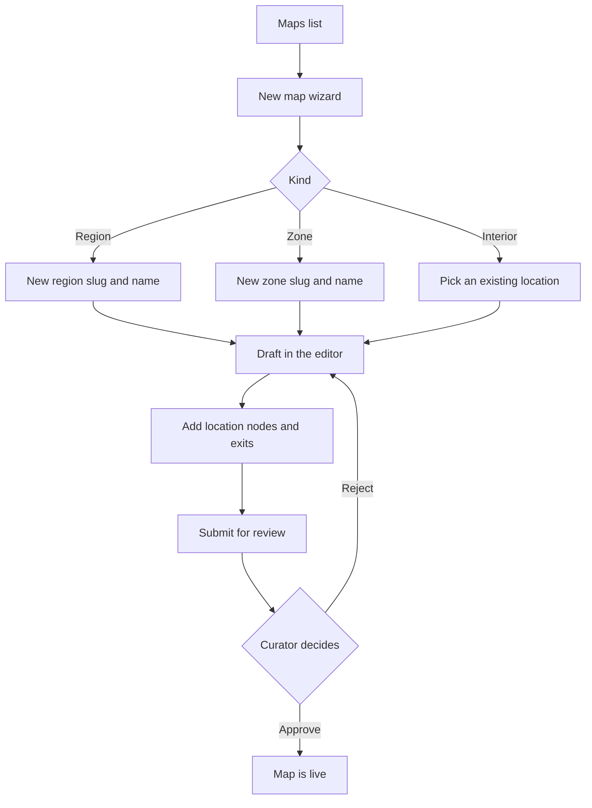

# Community map authoring (Milestone J)

The Foundry portal is public to signed-in accounts (see [`foundry-overhaul.md`](foundry-overhaul.md) §8), but
maps are still an editor-only craft: creating one needs `content.manage`, the create form asks for a raw slug,
and `save`/`delete` check nothing but the permission. This milestone makes map authoring a community activity
without turning the catalog into a free-for-all.

## 1. What already exists (verified)

| Piece | Where | State |
|---|---|---|
| Map kinds | `MapType` in [`MapGraphModels.cs`](../RealmEngine.Shared/Models/MapGraphModels.cs:7) | `World` (reserved, refused at creation), `Region` (nodes are zones + region exits), `Zone` (nodes are locations + exits), `Interior` (nodes are rooms; `OwnerId` is a `ZoneLocation` slug) |
| Node kinds | `MapNodeType` | `EntryPoint`, `Zone`, `Location`, `ZoneExit`, `RegionExit`, `Portal`, `Stair`, … |
| Connections | exit nodes carry `TargetMapId`/`TargetNodeId`; edges carry a direction | modelled, validated |
| Draft → submit → review | `MapEditorService` + `MapEditorEndpoints` | works; creation records `CreatedByAccountId` |
| World validator | [`MapGraphValidator.cs`](../RealmEngine.Data/Validation/MapGraphValidator.cs:41) | 20+ rules, including `target_map_unknown`, `target_node_unknown`, `node_reference_unknown`, `node_unreachable`, `map_without_exit`, `unlock_key_missing` |
| Locations | `ZoneLocations` table + the `Location` content type | authored as content; a `Location` node references one by slug |

**The two real gaps in the validator.** Everything above is per-map or per-node. Nothing checks that a map can
be *reached from somewhere* (an orphan zone nobody can walk to is legal), and nothing checks that the locations
of a zone actually appear on that zone's map (a zone with twelve locations and a three-node map is legal).

**The gap in the write path.** `SaveAsync`, `ValidateAsync` and `DeleteAsync` take no account id, so any holder
of `content.manage` can rewrite or delete anyone's map. That has to change before authorship means anything.

## 2. Decisions (taken here, change them if you disagree)

1. **Authorship is `MapEntity.CreatedByAccountId`**, not a new permission. A map's author may edit, submit and
   delete their own draft; `content.manage` may edit anything. No schema change.
2. **A map stays a catalog row with its lifecycle** — it does not become a `FoundrySubmission`. Inventing a
   second review path would duplicate H5's promotion model for no gain.
3. **Draft visibility is scoped**: a player sees live maps plus their own drafts; `content.manage` and
   `content.review` see everything. Same shape as `FoundrySubmissionScope`.
4. **A new zone does not need a `ZoneLocation` before the map exists**, but it should not be *approved* until
   it has one location node and an exit back to its region. That is a validator rule, not a wizard step —
   and note that `map_without_exit` is a **warning** today, so an approval is not currently blocked by it.
   J3 decided: `map_without_exit` stays a warning for the *save* (a half-made map is how a zone gets built) and
   blocks *publication* (`BlocksPublication` in `ReviewAsync`), so approval refuses it. `location_missing_node`
   is a warning, `node_reference_zone_mismatch` is an error.
5. **The wizard is a plain form** (kind → owner → name → create), consistent with the content create pages: no
   client state, one POST, then land in the editor.

## 3. Phases

### J0 — Ownership and visibility (server)

- A small `MapWriteContext(Guid AccountId, bool CanManageAny)` passed to the mutating service methods, or an
  account id parameter plus a `content.manage` flag the endpoint already knows. Refusal is a typed result
  (`StatusForbidden`) so the endpoint answers 403 with a message, not an exception.
- `MapEditorEndpoints`: create/save/validate/delete move from `RequireAuthorization(ManageContent)` to
  `RequireAuthorization()`; the service decides. `submit` stays author-or-editor. `review`/`deactivate` stay
  `content.review`.
- `ListAsync` gains a scope, and `MapSummaryDto`/`MapGraphDto` gain `canEdit` so the page disables the
  controls per map instead of per permission.
- Tests: a player cannot save or delete another account's map; the author can; an editor can; a player's list
  is own drafts plus live maps.

### J1 — `/maps/new`, the wizard

- Route `(foundry)/maps/new/+page.{server.ts,svelte}`: kind → owner → name, with the owner picker driven by
  `getMapTargets` for `Interior` (an existing location slug) and by a text slug for `Region`/`Zone`.
- The POST creates the draft and redirects to `/maps/{id}`; failures come back as a `fail()` message.
- `/maps` gains a primary "New map" action; the inline create form on the list is retired so there is one door.
- A fresh draft's editor page gets a short checklist: add the first location or zone node, add the exit that
  leads back, submit for review. Each item links to the control that does it.

### J2 — The Location-content step

- On a Zone map, a "Locations in this zone" panel lists the `ZoneLocation` rows whose `ZoneId` is the map's
  `OwnerId`, with a "create a location" link (the `Location` content type, prefilled with the zone) and an
  "add as node" action that appends a `Location` node referencing it.
- The inspector's location picker reuses the same list rather than a free-text slug.
- This is the bridge that makes "Region → Zone → ZoneLocation" a journey instead of three unrelated pages.

### J3 — Validator rules

- `map_unreachable` (**warning**): a map that no other map's exit targets and that is not the world/region
  entry. The world root is still reserved, so this starts as a warning and becomes an error once a root exists.
- `location_missing_node` (**warning**): on a Zone map, a `ZoneLocation` whose zone is this map's owner but
  which no node references.
- `node_reference_zone_mismatch` (**error**): a `Location` node whose slug belongs to a different zone.
- Both warnings must appear in the editor's validate output and in the submit gate's report; the audit gains a
  map section so `/world-health` shows them too.

### J4 — Review, notifications, docs

- The review queue's map rows show the validator verdict for the submitted version, so a reviewer sees what
  approving would put live.
- Verify a rejection and a deactivation notify the author (submission decisions already do).
- Update [`foundry-overhaul.md`](foundry-overhaul.md) §8's table, this file's status, `docs/client-ui-architecture.md`
  §5, and `.github/agent-memory/veldrath-memory.md`.

### Status

| Phase | Shipped |
|---|---|
| J0 | map writes are author-or-`content.manage` through `MapCaller`; the list and the single read are scoped (live maps plus your own drafts, everything for an editor or reviewer, another account's draft reads as 404); `canEdit` rides on both DTOs; validate is a session-only read — **shipped 2026-11-17** |
| J1 | `/maps/new` is the one create door: kind, owner and name, with the locations that already exist offered for an interior; the inline form left `/maps`; a fresh draft carries a checklist (first node, the way back, submit); the server refuses an interior whose location does not exist — **shipped 2026-11-17** |
| J2 | a zone map shows the locations of its own zone: the loader pairs them by `zoneId`, a panel adds one as a node with its slug prefilled, a Create a location link goes to the `zonelocation` form, and the inspector's reference picker offers this zone's locations only — **shipped 2026-11-17** |
| J3 | `node_reference_zone_mismatch` (error), `location_missing_node` and `map_unreachable` (warnings), and approval now refuses `map_without_exit` — **shipped 2026-11-17**; map findings are not on `/world-health` (see out of scope) |
| J4 | the review queue checks every submitted map (`getMap` + `validateMap`) and says whether approval would accept it or refuse it, naming a refusal with no error as the missing exit; a rejection and a deactivation both notify the author, titled with the map's name — **shipped 2026-11-17** |

## 4. Out of scope

- **Map findings on `/world-health`.** The audit is content-only — `ContentIssue` carries a content entity and a
  field — so the map rules surface in the editor's Validate and at approval instead. Teaching the audit about
  maps is its own phase.

- `MapType.World` authoring and the world root map.
- A map *submission* type in the Foundry queue (decision 2).
- Cross-map minimap rendering in the game client; the game keeps its own `cardinal-layout.ts`.
- Re-ordering or re-parenting an existing zone into a different region.
