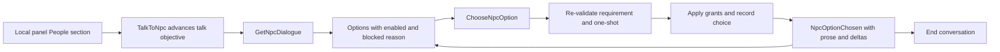

# Dialogue depth (E4) — options, requirements, consequences

> Opened 2026-11-20. This is the last unshipped phase of [`ui-depth.md`](ui-depth.md), and the
> only one whose prerequisites were **content**, not UI. Two of the three have since shipped:
> NPCs are placed ([`LocationNpc`](../Veldrath.Server/Data/Entities/LocationNpc.cs)) and talking
> to one works (`TalkToNpc` answers with an authored greeting and advances `talk:<slug>`). What
> is still missing is the part that makes a conversation a *decision*.

## 1. What exists, measured

| Piece | Where | Fact |
|---|---|---|
| The content row | [`Dialogue.cs`](../RealmEngine.Data/Entities/Content/Dialogue.cs:7) | `Speaker` + `Stats` (`Tone`, `Formality`, `Lines[]`) + six boolean traits. **A line pool.** No options, requirements, consequences or state. |
| The engine projection | [`EfCoreDialogueRepository`](../RealmEngine.Data/Repositories/EfCoreDialogueRepository.cs:35) | `GetBySpeakerAsync` returns `DialogueEntry(slug, name, typeKey, speaker, weight, lines)`. There is nowhere else for an option to live. |
| The talk path | [`NpcHubCommands.cs`](../Veldrath.Server/Features/Characters/Npcs/NpcHubCommands.cs:133) | Verifies the person is standing with the character, picks one greeting line, sends `NpcTalked`, then advances `talk:<slug>`. |
| Authoring | [`ContentSchema.cs`](../Veldrath.Contracts/Content/ContentSchema.cs:764), [`ContentEntityTypes.cs`](../RealmEngine.Data/Content/ContentEntityTypes.cs:53) | `dialogue` already has a schema, a validator key, a resolver and the generic write path — so extending the entity costs no new plumbing. |
| Seeded content | [`DialogueSeeder`](../RealmEngine.Data/Seeders/DialogueSeeder.cs) | Greeting and farewell lines for three townspeople. |

So E4 is no longer "a content-schema phase with a panel at the end" in the expensive sense: the
placement model exists, and the dialogue type is a first-class content type already reachable from
Foundry. It is a **column extension plus two bridges plus a panel**.

## 2. Decisions

| # | Decision | Choice |
|---|---|---|
| **L1** | Model | **Options on the existing entry**, stored in an owned JSON column (`DialogueStats.Options`). No node graph, no new content type, no new browse surface. A line pool becomes a prompt plus choices. |
| **L2** | Chaining | Each option may name `NextSlug` — another dialogue entry — **from day one**, unused by the seeded content. That is the whole of "dialogue trees" for now, and it means a later graph does not need a migration. No cycles in v1: the validator refuses a self-reference, and the client closes the panel at depth 3. |
| **L3** | Requirement vocabulary | A closed set validated at authoring time: `level` (minimum), `item` (slug + quantity, read from the character bag), `quest` (active / complete, by slug), `objective` (a `kind:key` at least N). Anything else is a validation error, not a no-op. |
| **L4** | Consequence vocabulary | `item` (slug + quantity into `CharacterBag`), `gold` (through the attributes gold key, one writer), `quest-start` (enrol, do not complete), `objective` (advance). Consequences are applied **server-side after re-validation**, never optimistically. |
| **L5** | One-shot safety | Anything that grants `item`, `gold` or `quest-start` is **one-shot by default**. Taken options are recorded per character in a small live table (`CharacterDialogueChoices`: character, speaker, option key, taken at) so a gold-bearing option cannot be farmed by clicking. An option that must repeat states `OneShot: false` explicitly. |
| **L6** | Availability is decided on the server | `GetNpcDialogue` returns every option with `Enabled` and a `BlockedReason` (what is missing, with the number), plus a consequence preview built from content. The client renders the preview and the reason; it never derives either (milestone rules D2 and D3). |
| **L7** | Transport | Two hub methods, both single-DTO bridges: `GetNpcDialogue(npcSlug)` and `ChooseNpcOption(speaker, optionKey)`. **`TalkToNpc` stays** — it is what advances `talk:<slug>` today and both the e2e specs and the parity suite depend on it; the new panel calls it first, then reads the conversation. |
| **L8** | Client | A `DialogueOverlay.svelte` in `web/client/src/lib/game/`, extracted per D5, opened from the Local panel's **People** section. A speaker with no authored entry says so loudly (`Unknown speaker: x`) rather than showing nothing. |
| **L9** | Foundry | Extend `DialogueSchema()` with the option list and its per-row fields. Editing a conversation is the same submission form the other content types use; no new page. |
| **L10** | No new exemptions | `hub-methods.test.ts` gets the two new methods with real consumers in the same commit. `TalkToNpc` keeps its existing caller; nothing is added to an allow-list to make the phase fit. |



## 3. Phases

| Phase | Work | Done when |
|---|---|---|
| **P1** ✅ | `DialogueOption` owned type + `DialogueStats.Options`; `DialogueSchema()` fields; `DialogueOptionGrammar`; `DialogueValidator` rules for L3/L4 (kinds, references resolve, unique option keys, caps) | An invalid option fails the write path and the audit names it; valid content round-trips through Foundry's form |
| **P2** ✅ | `GetNpcDialogue` handler + `NpcDialogue` payload (speaker, prose, options with enabled/reason/preview, `NextSlug` when present) | A character with the wrong level sees the option disabled with the requirement named; the payload-contract test and the parity suite pass |
| **P3** ✅ | `ChooseNpcOption` handler; `CharacterDialogueChoices` entity + migration; grants applied through `CharacterBag` / `AddGoldHubCommand` / `AcceptQuestHubCommand`; refusal of a stale, unknown, unmet or already-taken option | Choosing twice grants once; a refusal mutates nothing; every rejection path has a test |
| **P4** ✅ | `DialogueOverlay.svelte` + `dialogue.ts` display rules, `session.dialogue` state, People-section wiring, docs, and `dialogue.e2e.ts` in the `stack` run | The panel opens with the speaker's prose and closes on an ending choice; the e2e spec walks to the elder and asserts it against a fresh stack |

## 4. Content: authored in Foundry, not seeded

**Decision (2026-11-20): no seeded conversations.** The schema and the validator ship; the three
townspeople keep their greeting lines, and their conversations are authored by the content team in
the Foundry **Dialogues** form. Two reasons:

1. Seeders only **insert** by slug. A conversation authored in a seeder therefore never reaches a
   database that already has that entry — editing dialogue would mean `start --fresh` every time,
   which is not an authoring workflow.
2. Conversations are the part of this feature that will be re-written most often. Forcing those
   edits through C# and a reseed makes the cheapest change the most expensive one.

What the content team writes, per speaker, once the form has the Options group:

| Speaker | Where | Conversation to author |
|---|---|---|
| `wayfarer-elder` | Crestfall Square | Lore about the Ashlen Wood; an option that only unlocks at level 3; an option that hands over a healing draught |
| `village-blacksmith` | Aurelian Market | The lost-shipment handover as an option rather than only a `talk:` objective, plus a repair line naming the item they would need |
| `tavern-keeper` | Hearthbound Inn | A rumour naming a real seeded location, and a one-shot coin (gold out, nothing in — the one-shot rule made visible) |

Each needs at least one gated option and one granting option, so prose, requirement and
consequence are all visible in normal play rather than only in a test.

## 4a. What landed in P1 (2026-11-20)

- `DialogueStats.Options` + `DialogueOption` (`Key`, `Label`, `Response`, `NextSlug`, `OneShot`,
  `Requires`, `Grants`), mapped as `OwnsMany` inside the existing `Stats` JSON column.
- `DialogueOptionGrammar` — the closed vocabulary and the parser the validator **and** the runtime
  will use, so "valid" and "understood" cannot diverge. Authored form: `kind:subject[:detail][:amount]`.
- Rules: `dialogue_option_invalid`, `dialogue_effect_invalid`, `missing-dialogue-reference`,
  `dialogue_repeatable_grant` (warning). `ContentReferenceCatalog` gained `Quests` for the quest
  references.
- Foundry: a new **Options** group with an `ObjectList` row shape.
- **No migration.** `dotnet ef migrations has-pending-model-changes --context ContentDbContext`
  reports none: the options live inside the column that already exists.
- Tests: 56 for the grammar and the validator, 2 for persistence. The persistence pair uses
  **SQLite**, because InMemory keeps object references and would pass without proving the value
  reached the database.

## 5. Verification

```bash
dotnet build Realm.Full.slnx
dotnet test Realm.Full.slnx --configuration Release --no-build \
  --collect "XPlat Code Coverage" --settings coverage.runsettings --results-directory ./TestResults
node scripts/check-dotnet-coverage.mjs --report ./CoverageReport/Cobertura.xml --suggest

cd web && npm run typecheck && npm run lint && npm run test && npm run coverage --workspace client
./scripts/e2e-stack.sh start --fresh
cd web && npm run test:e2e:stack --workspace client    # includes the new dialogue spec
```

The negative controls that must be run before P3 is trusted: choose the same one-shot option
twice (second refuses, bag unchanged), choose an option whose item requirement is one short
(refused with the shortfall named), and send a stale option key that no longer exists in content
(refused, nothing mutated).

## 6. Out of scope

Portraits and voice, multi-hop branching beyond one `NextSlug`, dialogue-driven shop prices,
faction reputation, and quest *turn-in* as a conversation (that stays the quest log's job until
it has its own plan).
