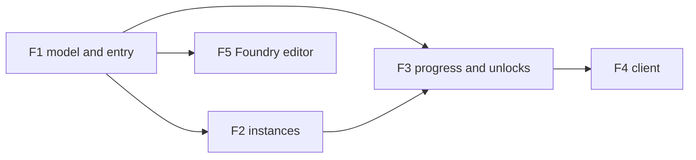

# Dungeons, instances and the map model

> **Status: F1–F4 shipped in [PR #70](https://git.kungraseri.cloud/Veldrath/Veldrath/pulls/70).**
> This file is the record of the model decisions and the phase outline. The Foundry map editor
> (§8) is an **outline only** and needs its own planning session before code.
>
> Supersedes the open question in [`ui-depth.md`](ui-depth.md) §3.6 — E6 becomes the client
> slice of this plan, and the model itself lives here.

---

## 1. What the world already is

The hierarchy is `World → Region → Zone → ZoneLocation`, and "where a character is" already has four
coordinates: [`PlayerSession`](../Veldrath.Server/Data/Entities/Zone.cs:56) holds `RegionId`, `ZoneId`,
`CurrentMapId` and `CurrentNodeId`.

Maps are explicit graph data, not tilemaps:

| Piece | Where | Fact |
|---|---|---|
| [`MapType`](../RealmEngine.Shared/Models/MapGraphModels.cs:7) | shared models | `World \| Region \| Zone \| Interior` (Interior added in F1) |
| [`MapNodeType`](../RealmEngine.Shared/Models/MapGraphModels.cs:21) | shared models | `EntryPoint, Zone, Location, ZoneExit, RegionExit, Portal, Stair, Landmark` |
| [`MapDirection`](../RealmEngine.Shared/Models/MapGraphModels.cs:50) | shared models | includes `Up`, `Down`, `In`, `Out` |
| [`MapEdgeType`](../RealmEngine.Shared/Models/MapGraphModels.cs:79) | shared models | `Walk, ExitToZone, ExitToRegion, Portal, Door` |
| `MapNode.TargetMapId/TargetNodeId` | shared models | **already** expresses "this node leads into another map" |
| [`Zone.Type`](../Veldrath.Server/Data/Entities/Zone.cs:59) | server | `Town \| Wilderness \| Dungeon` |
| [`ZoneLocation`](../RealmEngine.Data/Entities/Content/ZoneLocation.cs:7) | content | `TypeKey`, plus `Stats` (size, danger, min/max level, population) and `Traits` (`IsDungeon`, `IsIndoor`, `IsHidden`, `UnlockType/Key`, `IsDiscoverable`), plus an `ActorPool` of what spawns there |

**All five dungeons are already authored as zones with interior maps.** [`MapGraphSeeder`](../RealmEngine.Data/Seeders/MapGraphSeeder.cs:275)
gives each one a `MapType.Zone` map with an entry node, three named locations, one hidden
quest-locked deep room and edges; [`ZoneLocationsSeeder`](../RealmEngine.Data/Seeders/ZoneLocationsSeeder.cs:146)
seeds the matching locations; [`ApplicationDataSeeder`](../Veldrath.Server/Data/Seeders/ApplicationDataSeeder.cs:81)
seeds the zones themselves with a level floor and a parent region.

So the question was never "how do we model dungeons". It was "what do we do with the five we have,
and do we ever need a second model".

## 2. The decisions (2026-11-12)

| # | Decision | Choice |
|---|---|---|
| **D1** | Model | **A + B.** Keep authored zone maps *and* let a `ZoneLocation` contain rooms of its own, so a dungeon can be either a flat set of room-nodes or a location that opens into an interior graph. |
| **D2** | Instancing | **Per location, both kinds.** A `ZoneLocation` (or its interior) is either **public** — shared world state, everyone in it shares the enemies — or **instanced** — one copy per party. Some dungeons are one, some the other. |
| **D3** | Entry | **Both routes, one code path.** Travelling to the entrance on the map and the party-menu "enter dungeon" action must land in the same server command; neither may grow its own validation. |
| **D4** | Progress and reset | **Per-zone shared state with party rules** — and per instance for instanced locations. |
| **D5** | Death and escape | A **safe room (lobby)** in each dungeon, flagged per location, and an exit that always exists. |
| **D6** | Rooms | **Locations are the rooms.** No new room record type; `ZoneLocation` + its traits + its actor pool already carry what a room needs. |
| **D7** | Authoring | A **map editor in Foundry** (map graph, nodes, and what is in each location). Outline in §8; needs its own planning session. |
| **D8** | Level gating | **Soft gate.** `MinLevel` produces a warning, never a refusal: the player is told what the area expects and may walk in anyway. |

The engine's [`DungeonInstance`/`DungeonRoom`](../RealmEngine.Shared/Models/DungeonModels.cs:42) and
[`DungeonGeneratorService`](../RealmEngine.Core/Features/Exploration/Services/DungeonGeneratorService.cs:12)
are **not** adopted. They embed `Enemy` and `Item` objects inside rooms, which would resurrect the
save-game model that milestones D and C replaced with Postgres state. They stay as engine code for
non-server consumers and are not a roadmap.

## 3. The target model

### 3.1 Three map scopes, not two

`MapGraph` already has `OwnerId` and `TargetMapId`. It needs one more scope, and no new entity:

| `MapType` | `OwnerId` points at | Nodes are |
|---|---|---|
| `World` | world id | regions (reserved) |
| `Region` | region id | zone nodes and region exits |
| `Zone` | zone id | **locations** — and for a flat dungeon, those locations *are* the rooms |
| `Interior` *(new)* | **a `ZoneLocation` slug** | the rooms inside that location |

A zone's map can therefore hold a location node whose `TargetMapId` points at an `Interior` map
owned by that location. The traversal mechanism is not new: `TargetMapId`/`TargetNodeId` already
carries region ↔ zone transitions, and `TravelToNode` already follows it.

This is what D1's "A + B" buys, with one enum value:

- **Flat dungeon** (what the seeder already produces): the zone map's `Location` nodes are the rooms.
  No interior map, nothing to migrate.
- **Deep dungeon** (when a room needs its own space): a location opens into an `Interior` map whose
  nodes are rooms. A vault inside a barrow, a wing inside an estate.

### 3.2 Rooms are locations

D6 means a room is a `ZoneLocation` plus:

- `Traits.IsDungeon` / `IsIndoor` for framing,
- `Traits.IsHidden` + `UnlockType`/`UnlockKey` for the deep room,
- `Stats.DangerLevel` / `MinLevel` for the soft gate,
- `ActorPool` for "what is in this room" — already authored in Foundry,
- **`Traits.IsSafeRespawn`** (new use of an existing flag) for the lobby,
- **`Traits.IsInstanced`** (new flag) for D2.

Two flags on an owned JSON traits object is a migration plus a Foundry schema entry, not a new table.

### 3.3 Public and instanced locations

D2 asks for both, decided per location:

| | Public | Instanced |
|---|---|---|
| Enemy rows | one set per `(zone, location)`, shared — what the D3 sweeper already manages | one set per **instance** |
| Who is there | everyone in the zone at that node | one party |
| Reset | the respawn window on shared state | discarded when the instance empties |
| Party rule | the C3 rule stands: a party fights together because they are at the same location | the instance *is* the party boundary |

An instance needs an identity that reaches the state it scopes, and nothing else:

- `PlayerSession.InstanceId` (`Guid?`, null = public),
- `SpawnedEnemy.InstanceId` (`Guid?`), and the same on ground items and combat sessions,
- lookups keyed by `(location, instance)` instead of `(location)`.

That is a **schema change with a data rule**, not a rewrite: null keeps every existing row behaving
exactly as today, which is what makes this reversible.

#### The instance lifecycle (settled 2026-11-12)

**Who creates it: the server, on first entry.** No "open instance" command and no leader action —
entering *is* the creation, which is what keeps D3's single entry path single. The instance is keyed by
**`(partyId, zoneId, locationSlug)`**, so the party is the unit and a **solo player is a party of one**.
That removes the special case entirely: "instanced" means "not shared with strangers", which is what a
player expects, and it means the party aggregate from [`party-play.md`](party-play.md) is the only thing
that needs to know about instances.

**Late joiners:** a party member who travels to the entrance is looked up against their party's live
instance of that location and joins it. If the party has no live instance (nobody left, or it was swept)
entering creates a fresh one. A character with no party never joins someone else's — there is no
matchmaking, and the entrance says so in words rather than silently putting them in a public copy.

**Cleanup:** an instance ends when its **last member leaves** — an exit, a disconnect past the reconnect
grace, or a party disbanding. The sweep rides the respawn sweeper's existing tick rather than adding a
second timer, and it deletes the instance's enemy rows, ground items and cleared state. An instanced
dungeon is therefore fresh per run by construction, which is the point of instancing it.

**Reconnect:** the character's `InstanceId` travels on the session. On resume, if the instance is still
alive the character lands back in it; if it was swept, they wake in the dungeon's lobby with a message.
Entering a *different* dungeon leaves the previous instance, which then cleans up normally.

**Shared-quest credit: instancing changes which enemies you fought, nothing else.** There is one quest
system and one leaderboard:

- `kill:` objectives advance for the **participants of that enemy instance** — the C3 contribution rule,
  scoped by instance instead of by location.
- Two parties clearing their own copies of the same boss both complete "slay the Barrow King". Both did
  the deed; a public dungeon is where competition lives.
- The hardcore leaderboard records a **character** fact (who died, where, when), not a world fact, so it
  is unaffected by scope.
- No per-instance quest state, no "instanced variant" of a quest, no lockout.

**Settled in §F2.4:** an instance survives the disconnect grace — it only becomes *empty* once no
session points at it, so a relog rejoins the run rather than finding a fresh one. `MaxPlayers` caps
public locations only; an instance is exactly its party, so a cap would be a second, confusing limit.

### 3.4 Progress, reset and party rules

D4, with the instancing split above:

- **Cleared state** belongs to the scope: per zone for public locations, per instance for instanced
  ones. A record carrying `(zone, location, clearedAt, clearedByParty, bossDefeatedAt)` is enough —
  no per-character table.
- **Deep rooms unlock on quest**: today every hidden room has `UnlockType = "quest"` and
  `UnlockKey = null`, so nothing can ever unlock one. The key has to be authored, and the check must
  read the character's quest blob (the same keys the quest journal already uses).
- **Per-character first-clear** is recorded on the character's quest/achievement blob so a player can
  tell "I have done this" from "someone in my party has".
- **Public dungeons** repopulate on the existing respawn window; **instanced** ones are fresh per run.
  The wiki promise that "clearing a dungeon reduces enemy respawns" becomes: a cleared public dungeon
  gets a longer window, not a permanent empty state.

### 3.5 Entry, exit and the lobby

D3 and D5 in one command:

```
EnterLocation(zoneId, locationSlug)      ← the only entry point
  ├─ resolve the location and, if it opens, its Interior map
  ├─ D8 soft level gate: build a warning, never a refusal
  ├─ D2 public: join the shared state | instanced: find or create the run
  ├─ move the session: ZoneId, CurrentMapId, CurrentNodeId, ZoneInstanceId
  └─ broadcast LocationEntered / DungeonEntered to the right audience
```

- `TravelToNode` calls it when the target node is a location; the party-menu action calls it with the
  same arguments. **`EnterDungeon` becomes a thin alias** of that command rather than its own
  validator, and its current behaviour — validate the zone type, then do nothing — goes away.
- Every dungeon needs an **exit**: a `RegionExit` node and an `ExitToRegion` edge, so leaving is a
  walk, not a death.
- Every dungeon needs a **lobby**: one location flagged `IsSafeRespawn`, which is where A2's respawn
  puts you. Instanced dungeons resurrect inside their own instance.

### 3.6 The soft gate

`Zone.MinLevel` and `ZoneLocation.Stats.MinLevel` are both seeded and neither is enforced. D8 makes
them advisory: the entry response carries `recommendedLevel` and `yourLevel`, and the client shows a
banner — "This place expects level 11; you are 3" — with the warning repeated in the location panel.
A player who ignores it is allowed to.

## 4. Known content defects to fix while we are here

These are bugs in the seeded world, not new features. Fixing them is part of phase F1.

| Defect | Evidence | Effect today |
|---|---|---|
| Three dungeons have no way out | `barrow-deeps`, `sunken-name`, `kaldrek-maw` have no `RegionExit` node and no `ExitToRegion` edge | A character can only leave by dying |
| The Halrow's map is disconnected | edges connect `entry ↔ halrow-threshold` and `rootbound-cellars ↔ collapsed-vault`, but nothing joins the two halves | Two rooms are unreachable |
| The Drowning Pits' workings are sealed | `deepest-chamber ↔ flooded-workings` is an island; only `pit-descent ↔ entry` connects to the entrance | The two deepest rooms are unreachable |
| No deep room can unlock | every hidden room is `UnlockType = "quest"` with `UnlockKey = null` (and the map nodes carried the same null) | Boss rooms are permanently invisible |
| No zone has a safe respawn | no `ZoneLocation` is flagged `IsSafeRespawn`, so [`ResolveRespawnLocationAsync`](../Veldrath.Server/Features/Characters/Combat/RespawnHubCommand.cs:162) always falls through to the fallback | Every death logs an `Error` and tells the player their zone has no safe point |
| `MinLevel` never checked | seeded and exposed in DTOs, enforced nowhere | A level 1 character can enter Kaldrek's Maw |

The first two are the ones a map validator would have caught; that validator is part of F1 and the
editor in §8.

## 5. Phases

Each phase is independently shippable, and each ends with the parity allow-list one entry shorter.

### F1 — the model and the one entry path (detailed)

Everything here is public-location behaviour; instancing is F2 and changes none of it. Two findings
shrink the phase: `IsSafeRespawn` **already exists** on the shared
[`ZoneLocationEntry`](../RealmEngine.Shared/Models/ZoneLocationEntry.cs:20) record (the content entity
has no matching trait and the seeder never sets it), and a
[`MapGraphValidator`](../RealmEngine.Data/Validation/MapGraphValidator.cs:41) already exists with stable
issue codes — so this phase **extends** both rather than inventing them.

**1.1 — data and content model**

| Change | Where | Note |
|---|---|---|
| `MapType.Interior` | [`MapGraphModels.cs`](../RealmEngine.Shared/Models/MapGraphModels.cs:7) | serialised as a string, so no column migration |
| `Traits.IsSafeRespawn` | [`ZoneLocation.cs`](../RealmEngine.Data/Entities/Content/ZoneLocation.cs:55) `ZoneLocationTraits` | already existed; the seeder simply never set it. Owned JSON, so no schema migration |
| `Traits.IsInstanced` | same | consumed by F2, authored in F1. Also owned JSON: no schema migration (`SafeRespawn` set the precedent) |
| Map both traits onto `ZoneLocationEntry` | `EfCoreZoneLocationRepository` (entity → entry projection) | `IsSafeRespawn` was projected but unset; `IsInstanced` is new on the entry record |
| Accept `Interior` in the validator's scope rules | [`MapGraphValidator.cs`](../RealmEngine.Data/Validation/MapGraphValidator.cs:49) | an `Interior` map's owner must be a known **location** slug |

**1.2 — seed the world** (the §4 defect list, plus the data the model now needs)

- Exits for **barrow-deeps**, **sunken-name** and **kaldrek-maw**: a `RegionExit` node and an
  `ExitToRegion` edge back to their region map.
- **The Halrow**: join `halrow-threshold` (or `entry`) to `rootbound-cellars` so both cellar rooms are
  reachable from the entrance.
- **The Drowning Pits**: join `pit-descent` to `flooded-workings` so both deepest rooms are reachable.
- **Lobbies**: one location per dungeon flagged `IsSafeRespawn`, plus one per non-dev zone — nothing
  anywhere was flagged, which is why every death logged an `Error`.
- **Unlock keys**: give each hidden deep room a real `UnlockKey` (its own slug) instead of `null`, in
  `ZoneLocationsSeeder` **and** in the `MapGraphSeeder` node that mirrors it.
  `storm-watch-peak` (an `achievement` gate) had the same hole and got the same treatment.
- No `Interior` maps are authored in F1 unless a dungeon needs one; the capability lands before the
  first use, and a validator rule proves the shape.

**1.3 — one entry command** (shipped)

- `EnterZoneLocationHubCommand` resolves the zone, the location and the location's node on the zone
  map, then **delegates the move to `TravelToNodeHubCommand`**. There is still exactly one mover, so
  visibility, adjacency, the passive discovery sweep, the roster and persistence cannot drift apart.
- The D8 gate is built inside `TravelToNode` and travels on its result
  (`recommendedLevel`, `yourLevel`, `levelWarning`, plus `locationTypeKey`, `isInstanced`,
  `isSafeRespawn`), so a plain walk and the party action carry the same figures. Re-entering the node
  you already stand on reports them too — that branch is a real case, not an optimisation.
- `EnterDungeon(zoneSlug)` is now a thin alias: it resolves the dungeon's **lobby**
  (the `SafeRespawn` location, falling back to the first non-dungeon room) and calls
  `EnterZoneLocationHubCommand`. Its old body — validate the zone type, broadcast, move nobody — is gone.
- A character who is not standing in the zone is refused with the zone and the way in named, never
  moved: `"Travel to The Halrow first; The Halrow Threshold is the way in."`
- `EnterDungeon` answers the **caller** with the gate figures and announces the arrival to
  `OthersInGroup`; `EnterLocation` sends the arrival as `NodeTraveled` so the shell moves as it does
  when walking.

**1.4 — the validator and the seeded-world test**

New issue codes, in the existing `code` + `message` + severity style:

| Code | Severity | Rule |
|---|---|---|
| `node_unreachable` | Warning per map, **Error when the map belongs to a dungeon zone** | a non-entry node is not reachable from `EntryNodeId` |
| `map_without_exit` | Warning per map, **Error when the map belongs to a dungeon zone** | no `ZoneExit`/`RegionExit` node |
| `unlock_key_missing` | Error | `UnlockType` is `quest`, `item` or `achievement` but `UnlockKey` is empty. Skill-check unlocks gate on `DiscoverThreshold`, so they need no key |
| `target_map_unknown` | Error | `TargetMapId` names a map that is not in the known set (world scope) |
| `interior_owner_unknown` | Error | an `Interior` map's owner is not a known location slug |

The dungeon-only promotion matters: several non-dungeon zone maps ship without a `RegionExit` and with
rooms reachable only from an inbound zone exit. That is untidy, not fatal — a player can still walk out
through the zone exit — so it stays a warning. Inside a dungeon it is fatal, and it is exactly how the
Halrow's stranded cellars and the Drowning Pits' sealed workings shipped.

Wire it into the existing seeded-content test (`SeededContentValidationTests`) so the failure mode is
"the seed does not load", which is how the Halrow's stranded rooms should have been caught.

**1.5 — client (thin)**

Entering already works through the map; what F1 adds is that `LocationEntered` carries the location's
type and the soft-gate figures, and the shell shows the warning banner. Dungeon framing, the room list
and the exit control are F4.

**Definition of done for F1**

- Walking to The Halrow threshold and using the party action from the entrance arrive at the same
  location on the same map, through the same command.
- All five dungeons can be entered *and left* without dying; the Halrow's cellar rooms are reachable.
- A death in any zone no longer logs an `Error` and no longer says the zone has no safe point.
- The seeded world fails to load if a map has a stranded node, no exit, or an unlockable-by-nothing
  hidden room.
- A player entering Kaldrek's Maw at level 3 sees the warning and is not blocked.

**Tests for F1**

- Server: the entry command (happy path, not-at-entrance, unknown location, soft gate figures); the
  alias (`EnterDungeon` reaches the same result); validator cases for each new code, positive and
  negative; seeded-world validation green.
- Web: the warning banner renders from the payload and does not block entry.

### F2 — instance lifecycle

A run of a dungeon is a **row**, not a derived string: `ZoneInstance` is the aggregate root that
enemies, ground items, members and room progress point at. Identity is allocated once and stored; the
SignalR group name is computed *from* the row and is never parsed to recover identity.

**Done when:** two parties can clear the same instanced dungeon without seeing each other's enemies,
and an empty run disappears.

#### F2.1 The granularity decision: one run per zone, or one row per room

The five dungeons are **zone maps whose rooms are locations**, and the lobby is an ordinary shared
location. So a delve is "lobby, then three instanced rooms". Two shapes are possible:

```
A — zone-level run
    ZoneInstance  Id=R, ZoneId=the-halrow, OwnerPartyId=P
        EnemyInstance              R, rootbound-cellars, ...
        EnemyInstance              R, collapsed-vault, ...
        ZoneInstanceLocationState  R, rootbound-cellars, cleared
        ZoneInstanceLocationState  R, collapsed-vault, cleared

B — one row per instanced room
    ZoneInstance  Id=R1, ZoneId=the-halrow, LocationSlug=rootbound-cellars, Party=P
    ZoneInstance  Id=R2, ZoneId=the-halrow, LocationSlug=collapsed-vault,   Party=P
        EnemyInstance R1, ...
        EnemyInstance R2, ...
```

| Criterion | A — one run per zone | B — one row per room |
|---|---|---|
| What "this attempt" means | one object; a wipe, a reset and a first-clear all refer to it | nothing — an attempt is a set of unrelated rows |
| Boss stays dead while the party backtracks | automatic | only within that room; walk out and back and the room is a new run unless you keep its row open |
| Party split across two rooms | one group, one chat channel, one occupant list | two groups; party chat, occupants and `PlayerEntered`/`PlayerLeft` fragment per room |
| Late joiner | joins the run, lands wherever the party is | must be routed to the room the party occupies, and re-routed as they move |
| Respawn inside the instance | the run's lobby, then walk back | needs a rule for which room row to resurrect into |
| Quest credit and rewards | participants at run level; "cleared the dungeon" is a field | per room; "cleared the dungeon" is a union rebuilt every time |
| Cleanup | one row to mark empty, cascade deletes everything | N rows; a party that leaves one room but not another leaves half a run alive |
| Open-row invariant | `unique (ZoneId, OwnerPartyId) where State = Open` says exactly what is wanted | a party may legitimately hold four open rows at once, so no constraint can express "one run per party" |
| Rows per delve | 1 plus room-state rows | 1 per room, plus the same room-state questions anyway |
| F3 progress and reset | progress is a child table of the run | progress is the run row, but there is no run to hang lockout or first-clear state on |
| Code surface | group computed once per run and stored on it | group recomputed per room from two ids, and the session's group changes as you walk |

**Choice: A, with B's information modelled as children.** The run is zone-level; the *room* remains the
granularity of state through `ZoneInstanceLocationState`. B buys nothing A cannot express, and it loses
the three properties F3 and F4 depend on: a stable SignalR scope for the whole delve, one object that
means "this attempt", and a single row whose emptiness can be swept. The room-level detail that makes B
attractive lives on as child rows, not as the identity.

#### F2.2 Why not the derived string

`zone:{zoneId}#party:{partyId}` and `#solo:{characterId}` were the first proposal. They are cheap and
need no migration, and they are rejected for three reasons that only show up later:

1. **They conflate who with which run.** That key is one scope forever, so "reset the dungeon" and "the
   party is mid-run" become the same rows; F3 needs them distinguishable.
2. **Ghost scopes fail silently.** A mis-composed suffix spawns a private copy of the dungeon that
   nothing will ever clean up. A row plus a unique index turns that into a constraint violation.
3. **Party lifecycle rekeys live state.** Disband, leave or kick inside a room changes the key mid-run,
   so enemy rows, ground items and combat sessions all have to be re-keyed or the character silently
   changes instance.

What survives from that proposal is the useful part: the group name is still a single string, still
cheap to scope by, and still what SignalR joins. It is simply *allocated on the row* rather than
assembled at every call site — `zone:{zoneId}_{difficultyMode}#i1:{runId}`, composed in one place.

#### F2.3 The tables, beside the ones they replace

Current, for reference — the three tables that carry live world state today:

| `EnemyInstance` | `GroundItem` | `CombatSession` |
|---|---|---|
| `Id` | `Id` | `CharacterId` (PK) |
| `ZoneGroup` | `ZoneId` | `EnemyInstanceId` |
| `LocationSlug` | `LocationSlug` | `ZoneGroup` |
| `ArchetypeSlug` | `ItemRef` | `LocationSlug` |
| `Name`, `Level` | `Quantity`, `Durability` | `TurnCount`, `PlayerDefending` |
| `CurrentHealth`, `MaxHealth` | `DroppedByCharacterId` | `StartedAt`, `UpdatedAt` |
| `BaseXp`, `GoldReward` | `DroppedAt` | `DisconnectedAt` |
| `IsAlive`, `SpawnedAt`, `RespawnAt`, `Version` | — | — |
| participants, combat sessions | — | enemy, character |

The world is scoped three different ways today: `ZoneGroup` + `LocationSlug` on enemies and combat,
`ZoneId` + `LocationSlug` on ground items, and nothing at all on sessions. That is the inconsistency
instancing exposes, and it is why ground items cannot currently be instanced without a key change.

Proposed. Only the columns in **bold** change on existing rows:

| `ZoneInstance` (new) | `EnemyInstance` | `GroundItem` | `CombatSession` | `PlayerSession` |
|---|---|---|---|---|
| `Id` (Guid, PK) | `Id` | `Id` | `CharacterId` (PK) | `Id` |
| `ZoneId` | `ZoneGroup` kept as transport | `ZoneId` kept | `EnemyInstanceId` | `CharacterId` |
| `OwnerPartyId` null for solo | **`ZoneInstanceId` (Guid?)** | **`ZoneInstanceId` (Guid?)** | `ZoneGroup` kept | `ConnectionId` |
| `CreatedByCharacterId` | `LocationSlug` | `LocationSlug` | `LocationSlug` | `RegionId`, `ZoneId` |
| `ZoneGroup` allocated once | `ArchetypeSlug`, `Name`, `Level` | `ItemRef`, `Quantity`, `Durability` | `TurnCount`, `PlayerDefending` | `CurrentMapId`, `CurrentNodeId` |
| `State`: Open, Empty, Purging | `CurrentHealth`, `MaxHealth` | `DroppedByCharacterId`, `DroppedAt` | `StartedAt`, `UpdatedAt` | **`ZoneInstanceId` (Guid?)** |
| `CreatedAt`, `LastOccupiedAt` | `BaseXp`, `GoldReward` | — | `DisconnectedAt` | `EnteredAt` |
| `RowVersion` | `IsAlive`, `SpawnedAt`, `RespawnAt`, `Version` | — | — | — |

Three deliberate non-changes:

- **`ZoneGroup` stays on enemies and combat.** It is the broadcast address, it is already indexed, and
  removing it would churn every spawn and attack path for no gain.
- **`CombatSession` gets no `ZoneInstanceId`.** It already has `EnemyInstanceId`, so the run is one join
  away; a second column would be a second answer to the same question on the hottest write path.
- **`GroundItem` keeps `ZoneId`.** It is still the cheapest way to answer "what is on the floor in this
  zone" for the public case, where `ZoneInstanceId` is null.

Two new children of the run:

| `ZoneInstanceParticipant` | `ZoneInstanceLocationState` (F3) |
|---|---|
| `ZoneInstanceId` | `ZoneInstanceId` |
| `CharacterId` | `LocationSlug` |
| `JoinedAt` | `IsCleared`, `ClearedAt` |
| `LeftAt` null while inside | `FirstClearedByCharacterId`, `FirstClearedAt` |
| PK `ZoneInstanceId, CharacterId` | PK `ZoneInstanceId, LocationSlug` |

Participants exist so credit survives a disconnect or an early exit. The existing `EnemyParticipant`
answers "who damaged this mob", not "who was on this run".

Indexes, and the one race:

```sql
-- one open run per party, per zone
create unique index ix_zone_instance_open_party
    on "ZoneInstances" ("ZoneId", "OwnerPartyId")
    where "OwnerPartyId" is not null and "State" = 0;

-- one open run per solo character, per zone
create unique index ix_zone_instance_open_solo
    on "ZoneInstances" ("ZoneId", "CreatedByCharacterId")
    where "OwnerPartyId" is null and "State" = 0;

create index ix_enemy_instance_run on "EnemyInstances" ("ZoneInstanceId", "LocationSlug");
create index ix_ground_item_run on "GroundItems" ("ZoneInstanceId", "LocationSlug");
```

Two members entering the same room at the same instant: one insert wins the partial index, the loser
catches `DbUpdateException`, re-reads and joins. This is the same shape as the existing spawn race in
[`GetAliveOrSpawnAsync`](../Veldrath.Server/Features/Characters/Combat/EfCoreEnemyInstanceStore.cs:84),
which already logs and adopts the winner.

#### F2.4 The lifecycle, in rules

| Moment | Behaviour |
|---|---|
| Enter a **public** location | no row; the group stays `zone:{zoneId}`; everything works as today |
| Enter an **instanced** location | find an open run for the zone and party; else one for the zone and solo character; else insert. Then join its group |
| Solo player | `OwnerPartyId` null, run keyed by character — still a real run, so a retry after emptying gets a new id |
| Late joiner | the same lookup, so a party member always lands in the party's run; nobody is ever told an instance id |
| Leave the last instanced room | the run stays Open while any `PlayerSession` points at it, including from the lobby, so backtracking keeps the attempt |
| The run empties | State Empty and `LastOccupiedAt` now; after a configurable grace, Purging then delete, cascading enemies, ground items, participants and room state |
| Party disbands inside | `OwnerPartyId` is provenance, not a live foreign key; the run survives until empty |
| Death | respawn at the run's lobby if the run is still open, otherwise the public zone lobby |
| Disconnect and reconnect | `PlayerSession.ZoneInstanceId` restores the run; the group is recomputed from the row |

#### F2.5 Hardening rules

1. One formatter and one parser for the group name, unit-tested; nothing else concatenates.
2. Never recover identity by parsing a group name; business logic carries `ZoneInstanceId`.
3. Never accept an instance id or group name from a client — not chat commands, not summon effects, not
   Foundry tooling. The server joins groups.
4. Version the suffix (`#i1:`) so a format change is detected rather than silently reinterpreted.
5. Fix the composition order with the existing modifier: `zone:{zoneId}_{difficultyMode}#i1:{runId}`.
6. Emptiness respects the disconnect grace, so a relog rejoins the run instead of finding a fresh one.
7. Never show a run id to a player. "Attempt 3" at most.
8. Ship an operator lever: list open runs and purge one, so a stuck run is fixable without SQL.

#### F2.6 Order of work

| Step | Ships | Tests |
|---|---|---|
| 1 | `ZoneInstance` entity, `ZoneInstanceState`, `ZoneGroupName` value object, migration | formatter and parser round-trip, including a wilderness hardcore instance |
| 2 | `IZoneInstanceService` with find-or-create, unique-index retry, emptiness and purge | party join, solo join, concurrent join, disband, empty then purge |
| 3 | `PlayerSession.ZoneInstanceId`, arrival carries the effective group, hub moves the connection between groups | group switch on entry, group restored on reconnect, public path unchanged |
| 4 | `EnemyInstance.ZoneInstanceId` and `GroundItem.ZoneInstanceId`; reads key on the run when it is set | two parties clearing the same rooms see different enemies and different floor loot |
| 5 | Instance-scoped respawn | death inside a run resurrects in its lobby; death in a purged run falls back to the zone |
| 6 | Operator endpoint: list and purge | authenticated, audit-logged, refuses a non-staff caller |

**Shipped status.** Steps 1–6 are in. Two details settled while implementing them:

- **Ground items need the scope as a required argument**, not a defaulted one. `GetAtLocationAsync` now takes
  `Guid? zoneInstanceId` in the same position as the run it reads, so a caller cannot accidentally ask for a
  location without saying whose loot it means. The pickup path answers "you are not standing where that item
  was dropped" for another run as well as another zone — the client must not learn that a run it is not in
  exists.
- **Respawn falls back deliberately.** A death inside a run revives in that run's lobby because the session's
  group still points there. If the run was purged while the character was dead, the hub clears the pointer,
  moves the connection back to the shared zone group and says so — waking up in a group nobody else can join
  would be worse than the fallback.

### F3 — progress, reset and unlocks (shipped)

- Cleared/boss state per scope, the longer respawn window for a cleared public dungeon, quest unlock
  keys for the deep rooms, per-character first-clear.
- **Done when:** the deep room opens for a character on the right quest, the boss stays dead for the
  window, and a cleared dungeon says so.

What shipped:

- `ZoneInstanceLocationState` holds the run's cleared rooms, with `FirstClearedByCharacterId` as the
  party-facing credit. `GetClearedLocationsAsync` feeds the arrival payload and `RecordClearAsync` is the
  one writer.
- **A room clears when its last enemy dies**, not when a specific one does:
  `IEnemyInstanceStore.CountAliveAsync` answers without spawning (a read that spawned would answer "no"
  forever), and `AttackEnemyHubCommandHandler` records the clear only when it reads zero.
- **First-clear is per character and persistent**, stored as `FirstClear_{slug}` on the character attributes
  blob — the same mechanism the skill sheet uses — so "I have done this" survives the run that proved it.
  The run's own first-clear is separate, so a late joiner who kills nothing is not credited with the room.
- **Quest credit is the authored unlock key.** Clearing a room grants the character every hidden location
  whose `UnlockKey` names that room, which is the link the seed data now carries. The hub announces the
  reveal and the location becomes visible through the existing discovery filter.
- `LocationCleared` carries the outcome to the whole run, so a party sees progress without polling.

- **A cleared room really is quieter.** §6 promises "a longer respawn window, not a schedule", and that is now
  what happens: when a location's last enemy dies, every dead row there is pushed to the cleared-room window
  (`ClearedRoomRespawnMultiplier`, default 3× the normal delay). It applies to a public dungeon and to a run
  alike, because the promise was never about instancing. The multiplier is a single configured number, which
  is honest: it is a starting point for the balance pass, not a measurement.

### F4 — the client (shipped)

- Dungeon framing (you are underground, not in a field), the room list from the map graph with the
  current room marked, progress, an always-available exit control, and the D8 warning banner.
- **Done when:** a player can see where they are in a dungeon, what is left, and how to leave.

What shipped: [`dungeon.ts`](../web/client/src/lib/game/dungeon.ts) holds the rules — a dungeon is a zone
whose type says so, rooms are the visible location nodes in authored order, and the exit prefers a region
exit and falls back to a zone exit — and
[`DungeonPanel.svelte`](../web/client/src/lib/game/DungeonPanel.svelte) renders them above the map whenever
the zone is a dungeon: the rooms with the current one marked and the cleared ones ticked, `n/m rooms
cleared`, an always-available "Leave the dungeon", "Walk here" for adjacent rooms, and "Enter room" for the
room the character is standing in, which is the party action calling the same entry command as walking.
`LocationCleared` and the arrival payload keep it current, so nothing polls.

Deferred: a visually distinct underground framing (the panel is the surface, not new art) and any per-room
artwork.

### F5 — Foundry map editor

Outline in §8. Its own milestone.

## 6. What this deliberately does not do

- **No room records.** D6: a room is a location.
- **No engine `DungeonInstance`.** Rejected in §2.
- **No procedural generation.** The engine generator stays unused until someone wants it; the world
  is authored.
- **No lockouts or daily resets.** A cleared public dungeon is a longer respawn window, not a
  schedule.
- **No matchmaking.** An instance belongs to a party; there is nothing to match.
- **No PvP in dungeons.** `Zone.IsPvpEnabled` exists and stays off.

## 7. Order and dependencies



F1 before everything: nothing else can be tested while entry does not move a character and three
dungeons have no exit. F2 before F3 because cleared state has to know which scope it belongs to.
F4 last because it renders what F1–F3 settle. F5 can start once F1's data shape is stable.

## 8. Foundry map editor (shipped: read, inspect, save)

The write path and the editor page are in. What shipped:

- **Server.** `MapEditorService` behind `GET /api/content/maps` (list with versions), `GET
  /api/content/maps/{id}` (the whole graph) and `PUT /api/content/maps/{id}` (save), all under the existing
  `content.manage` permission. A save replaces this map's candidate inside the whole world and runs
  `MapGraphValidator.ValidateWorld`, so it cannot strand a room, leave a dungeon without an exit, or point an
  exit at a map that does not exist. It is refused rather than half-applied, and the refusal carries the issue
  codes the validator already emits. Saves are optimistic: the caller sends the version it started from and a
  mismatch is a `409` conflict.
- **Web.** [`/foundry/maps`](../web/client/src/routes/(foundry)/maps/+page.server.ts) lists graphs with their
  size and version; [`/foundry/maps/[mapId]`](../web/client/src/routes/(foundry)/maps/[mapId]/+page.svelte)
  shows every node with its label, hidden flag, unlock key and exit target editable, and its edge counts
  read-only. Rules live in [`map-editor.ts`](../web/client/src/lib/foundry/map-editor.ts) so they are unit
  tested, and `applyNodeEdits` touches only the fields the inspector owns — edges and the version survive by
  construction.
- **Why it matters.** The Halrow's stranded rooms and the three missing exits were exactly what a human
  looking at the graph would have seen.

Still needs its own session:

- **The canvas.** Nodes are edited in a table today. Dragging them on `LayoutX`/`LayoutY` (the data the
  client's `CardinalMap` already reads) and drawing edges with `MapDirection` is the next step;
  `cardinal-layout.ts` is reusable for the read-only preview that goes with it.
- **Create and delete.** The editor edits existing graphs; adding a map, or deleting one, is a separate
  decision with its own cascade.
- **Actor pools and location traits.** Those live on `ZoneLocation`, not on the graph, so they belong with
  the location editor rather than here.

What the original outline asked for, for reference:

1. **Route and RBAC.** A `(foundry)/maps` area behind the existing content permission, listing the
   three scopes and their owners.
2. **The canvas.** Nodes placed by `LayoutX`/`LayoutY` (the data the client's `CardinalMap` already
   reads), draggable, with edges that follow `MapDirection`; the cardinal layout logic in
   `web/client/src/lib/game/cardinal-layout.ts` is reusable for a read-only preview today.
3. **Node inspector.** Type, `RefId`, display name and description, `IsHidden`, `UnlockType` and
   `UnlockKey`, `DiscoverThreshold`, and for a location: the actor pool, `IsSafeRespawn`,
   `IsInstanced`, and the `TargetMapId` that opens its interior.
4. **Write path.** Map graphs are currently seeded from JSON only. The editor needs endpoints next to
   the existing Foundry write path, validation before save (the F1 validator), and row versions for
   concurrent edits.
5. **The thing this fixes.** The Halrow's stranded rooms and the three missing exits are exactly what
   a human looking at the graph would have seen; the editor is worth building for that alone.

---

## See also

- [`ui-depth.md`](ui-depth.md) — milestone E; E6 is this plan's client slice.
- [`server-first-world-state.md`](server-first-world-state.md) — the enemy and combat state that F2
  has to scope by instance.
- [`party-play.md`](party-play.md) — the party aggregate an instance is built for.
- [`docs/client-ui-architecture.md`](../docs/client-ui-architecture.md) — the panel-driven client and
  the DB map graph.
- [`wiki/Veldrath-World.md`](../wiki/Veldrath-World.md), [`wiki/Region-Varenmark.md`](../wiki/Region-Varenmark.md)
  — the authored world and its dungeon zones.
