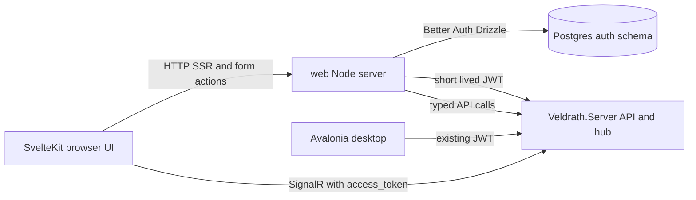

# SvelteKit Migration Plan

## Status

> **This plan is complete.** Phases 0–6 shipped and the Blazor applications are deleted. The
> three items that were never finished here — authenticated browser coverage of the game loop,
> the Windows WebView2 runtime smoke, and payload/contract drift — moved to
> [`plans/blazor-decommission-and-cleanup.md`](blazor-decommission-and-cleanup.md) as W7, W8, and W9.
> Keep this file as the decision record; do not add new work to it.

Phase 0 is complete and verified on the existing Blazor Postgres database:

- The template moved to `web/`; Colyseus, the TypeScript engine, the ticket helper, and the room schema were removed.
- Better Auth owns the `auth` schema; `auth.user`, `auth.session`, `auth.account`, `auth.verification`, and `auth.__drizzle_migrations` exist.
- The SvelteKit server mints a JWT that `Veldrath.Server` accepts.
- `/api/characters` returns `200` with the minted token, `/hubs/game/negotiate` returns `200`, and a real WebSocket connection receives `ServerInfo`.
- `npm run typecheck`, `npm run lint`, `npm run build`, and `npm run test` pass.
- Discord, Google, and Microsoft social providers are configured and Discord login is confirmed working.

Phase 1 is complete and verified:

- [`JwtClaimsEnrichment`](../Veldrath.Server/Features/Auth/JwtClaimsEnrichment.cs) runs on `JwtBearerEvents.OnTokenValidated` and enriches identity-only SvelteKit tokens with Identity role and `permission` claims.
- [`AccountProvisioningService`](../Veldrath.Server/Features/Auth/AccountProvisioningService.cs) provisions a `PlayerAccount` for an unknown `sub` GUID on first use, using the Better Auth username/email claims. Account-access snapshots are cached for 60 seconds per account, and concurrent provisioning races are handled.
- [`RolePermissionResolver`](../Veldrath.Server/Features/Auth/RolePermissionResolver.cs) is shared by token issuance and inbound enrichment so both paths derive RBAC claims identically.
- The SvelteKit game token now includes `email` and `email_verified` claims.
- The temporary Foundry bridge (`InternalAccountBridgeEndpoints` + `foundry-bridge.ts`) mirrored registration passwords and OAuth logins into Identity, guarded by `INTERNAL_BRIDGE_TOKEN`. **Deleted with the desktop client (2026-10-25)** — accounts are provisioned just in time from Better Auth claims instead, and only the email relay still uses the bridge secret.
- [`migrate-identity-accounts.mjs`](../web/scripts/migrate-identity-accounts.mjs) copies `AspNetUsers` and `AspNetUserLogins` into Better Auth with matching GUIDs. Legacy Identity PBKDF2 hashes stay valid through the dual-format verifier in [`auth-password.ts`](../web/client/src/lib/server/auth-password.ts).
- Live verification at the time: a Better Auth user with no `AspNetUsers` row received `200` from `/api/characters` and the row was provisioned with the token GUID; the bridge's register route returned `synced: true`; .NET `/api/auth/login` succeeded for the bridged password; after migrating an Identity-only account, Better Auth `/api/auth/sign-in/email` succeeded with the legacy password and `/api/characters` returned `200`.
- `Veldrath.Server.Tests` passes (776 tests, including 13 provisioning/bridge tests); client Vitest passes (4 password-verifier tests).
- The first vertical slice is live:
  - [`/characters`](../web/client/src/routes/characters/+page.svelte) loads the account roster through SSR using a freshly minted game token.
  - [`/play/[id]`](../web/client/src/routes/play/[id]/+page.svelte) connects SignalR, selects the character, enters the zone, renders the map, travels between nodes, and opens the inventory overlay.
  - [`GameSession`](../web/client/src/lib/game/session.svelte.ts) reduces hub events into Svelte runes and handles reconnect.
  - Live smoke result: `CharacterSelected` → `ZoneEntered` (Aldenmere) → `MapGraphReceived` (4 nodes) → `TravelToNode` (Grey Cup) → `InventoryLoaded` with no hub errors.
  - Playwright covers unauthenticated redirects for `/characters`, `/play/:id`, and `/game`.

Phase 2 is complete and verified for the SvelteKit client:

- `CardinalGraphLayout` is ported to [`cardinal-layout.ts`](../web/client/src/lib/game/cardinal-layout.ts) with all 13 Vitest cases; [`CardinalMap.svelte`](../web/client/src/lib/game/CardinalMap.svelte) renders the placed graph.
- The game shell is ported: [`GameHeader`](../web/client/src/lib/game/GameHeader.svelte), [`LeftSidebar`](../web/client/src/lib/game/LeftSidebar.svelte), [`RightSidebar`](../web/client/src/lib/game/RightSidebar.svelte) (chat), [`CombatPanel`](../web/client/src/lib/game/CombatPanel.svelte), and [`GameOverlays`](../web/client/src/lib/game/GameOverlays.svelte) (shop, quests, settings). The original `GameFooter` was retired in the Session-70 HUD rework — see [`docs/client-ui-architecture.md`](../docs/client-ui-architecture.md).
- [`GameSession`](../web/client/src/lib/game/session.svelte.ts) handles character/zone/map, travel, chat, inventory/equipment, combat, rest, search, shop, quests, XP/gold/health/mana, respawn, and reconnect. Pure event math lives in [`reducers.ts`](../web/client/src/lib/game/reducers.ts) with Vitest coverage.
- Browser SignalR verification exposed a CORS gap: negotiate preflights send `x-signalr-user-agent`. The server now allows that header and builds origins from `Cors:AllowedOrigins` (falling back to local dev plus `Web:BaseUrl`), with regression tests.
- Verification: 778 server tests, **31** client unit/component tests, 4 Playwright guard tests, live hub smoke (chat, rest, search, quest log, shop catalog, inventory), and a real-browser smoke (map, inventory, quests, settings, chat, zero console errors). Combat events are covered by reducer/component tests; the seeded zone spawns no live enemies.

Phase 3 is complete and verified for the SvelteKit public site and account pages:

- SSR public routes: [`/`](../web/client/src/routes/+page.svelte) (announcements, latest lore, patch notes, server status), [`/lore`](../web/client/src/routes/lore/+page.svelte) and `/lore/[slug]`, [`/patch-notes`](../web/client/src/routes/patch-notes/+page.svelte) and `/patch-notes/[slug]`, [`/community`](../web/client/src/routes/community/+page.svelte), and [`/players/[id]`](../web/client/src/routes/players/[id]/+page.svelte).
- Auth and account routes: `/login`, `/register`, `/forgot-password`, `/reset-password`, `/verify-email`, and [`/account`](../web/client/src/routes/account/+page.svelte) (profile, linked providers, password change, sign-out).
- [`editorial-api.ts`](../web/client/src/lib/server/editorial-api.ts) parses the server's `PagedResult` shape (`items`/`totalCount`) for lore, patch notes, and announcements, with empty-page fallbacks and a 5s timeout.
- [`markdown.ts`](../web/client/src/lib/server/markdown.ts) renders content with `marked` and `sanitize-html`; anchors get `rel="noopener noreferrer"`. Verified that an injected `<script>` payload is stripped from the rendered page.
- The account provider query lives in [`account.ts`](../web/client/src/lib/server/account.ts) so routes never import `@veldrath/shared/db` directly (DB boundary lint rule).
- Verification: `format`, `typecheck`, `lint`, production build, **31** Vitest tests, and **10** Playwright tests pass. Live SSR checks covered every page with seeded editorial rows; the live account flow passed sign-up → provider list → password change (browser `Origin` required by Better Auth CSRF) → Foundry bridge password sync → Better Auth and .NET Identity login with the new password while the old password was rejected.
- The Blazor public routes remain in `Veldrath.Web` until the Phase 6 retirement so the current deployment keeps working until SvelteKit is deployed; SvelteKit is now the canonical implementation.

Phase 4 is complete and verified for the SvelteKit staff portals:

- Route groups now mirror the Foundry surfaces: `(foundry)` (submissions, notifications, content browser, languages + builder), `(editorial)` (lore, patch notes, announcements), `(admin)` (dashboard, users, roles, audit, sessions, reports, status, server commands), and `(mod)` (dashboard, user search/detail, reports).
- Typed server clients replace `RealmFoundryApiClient`: [`game-request.ts`](../web/client/src/lib/server/game-request.ts), [`foundry-api.ts`](../web/client/src/lib/server/foundry-api.ts), [`content-api.ts`](../web/client/src/lib/server/content-api.ts), [`admin-api.ts`](../web/client/src/lib/server/admin-api.ts), and the editorial admin additions in [`editorial-api.ts`](../web/client/src/lib/server/editorial-api.ts).
- [`access.ts`](../web/client/src/lib/server/access.ts) resolves RBAC from `GET /api/account/profile` using a minted game token and mirrors the server's role/permission constants. Group layouts enforce `admin.users`, `content.manage`, and `players.view`; Foundry requires authentication. Root layout data drives conditional Foundry/Editorial/Mod/Admin nav links.
- Foundry review remains Curator-role gated to match the server's legacy `Curator` policy. `FoundryContentType.Language` was added (with a regression test) so the language builder matches `ContentSchemaRegistry`.
- Verification: typecheck/lint/format clean, production build, **31** Vitest tests, **15** Playwright tests (5 staff guards), and **30** Foundry server tests. Live verification on the local stack covered every gated page with an Admin+Curator account, editorial create → publish → public visibility → delete, Foundry create → vote → Curator approve → notification + audit entry, the language builder, and an admin broadcast.
- RealmFoundry Blazor is functionally superseded; the project is deleted in Phase 6 together with `Veldrath.Web`.

> **Superseded (2026-10-24):** the desktop client was deleted — Veldrath is web-first. Phase 5 below is
> kept as a historical record of how the WebView2 shell worked; `Veldrath.Client`,
> `Veldrath.GameClient.Core`, `Veldrath.Auth`, `DesktopUiServer`, the `/desktop` route, and the
> adapter-static build no longer exist.

Phase 5 is complete for the desktop client (WebView2 execution verified on the build/test path; a Windows runtime smoke remains):

- `DesktopUiServer` replaces the embedded Blazor `HostedGameServer`. It serves the static Svelte build from a random loopback port, exposes `/health`, and reverse-proxies `/api` and `/hubs` (including WebSockets) to the game server while injecting the desktop JWT server-side.
- [`vite.config.ts`](../web/client/vite.config.ts) switches to `@sveltejs/adapter-static` for `vite build --mode desktop`, producing a pure SPA fallback in `web/client/build-desktop` (ignored by git, copied into `Veldrath.Client` output as `SvelteApp/` when present).
- The client-only `/desktop` route loaded characters through the same-origin proxy, then reused the shared [`GameScreen`](../web/client/src/lib/game/GameScreen.svelte) and `GameSession`. `/play/[id]` now uses the same component.
- The root layout hides the website chrome on `/desktop` and tolerates missing server data in the SPA fallback.
- The desktop client no longer references `Veldrath.GameClient.Components` or `Veldrath.Auth.Blazor`. The native Avalonia UI remains the fallback when WebView2 is unavailable; Tauri remains deferred.
- Verification: `npm run build:desktop`, typecheck/lint, **677** `Veldrath.Client.Tests` (including 7 `DesktopUiServer` integration tests for static hosting, SPA fallback, auth-injecting proxying, 401 handling, and shutdown), and a Chromium smoke of the static bundle with a mocked character API.

Phase 6 is complete:

- Deleted `Veldrath.Web`, `Veldrath.Web.Tests`, `RealmFoundry`, `RealmFoundry.Tests`, `Veldrath.Auth.Blazor`, `Veldrath.GameClient.Components`, and `Veldrath.GameClient.Components.Tests`, plus `Veldrath.Web.slnx`, `RealmFoundry.slnx`, the `web`/`foundry` version props, the Foundry CI workflow, and the MudBlazor/bunit/Markdig/HtmlSanitizer package entries.
- Updated `Realm.Full.slnx`, `Veldrath.slnx`, `Veldrath.Client.slnx`, `Veldrath.Libraries.slnx`, and `RealmForge.slnx`; `Veldrath.Auth.Tests` now references only the shared `Veldrath.Auth` library.
- Removed the Foundry service and volumes from all compose files and the Foundry tag/release/deploy paths. `ci-web.yml` now also builds the static desktop bundle; `ci-client.yml` builds it before the .NET client so `SvelteApp/` is bundled.
- Kept the .NET auth endpoints and the internal SvelteKit → Identity bridge: the desktop client's native fallback still signs in through ASP.NET Core Identity. OAuth redirect validation now falls back to `Web:BaseUrl` when `Foundry:BaseUrl` is absent.
- Replaced the old Veldrath.Web/RealmFoundry VS Code launch/task entries with `web:dev`, `web:build`, `web:desktop`, `web:test`, and a SvelteKit launch/compound configuration.
- Updated `AGENTS.md`, the build-strategy and testing instructions, deployment docs, the design-system migration note, and removed the obsolete Blazor/MudBlazor instruction files, `llms.txt`, and the `run-realmfoundry` skill.
- Verification: full `Realm.Full.slnx` build, **4,617** .NET tests across 9 projects, SvelteKit typecheck/lint, **31** Vitest, **15** Playwright, and the web and desktop builds.

## Decision

Replace the Blazor frontends with a **single SvelteKit application** using route groups, built from the in-repo `Veldrath.Web.Sveltekit` template workspace (since moved into [`web/`](../web/); the template folder no longer exists).

- The SvelteKit app becomes the only web frontend: public site, auth pages, game client, Foundry, admin, moderation, and editorial.
- The `Veldrath.Server` .NET app remains the API and SignalR hub. It is not rewritten.
- Better Auth owns web credentials and sessions and connects directly to Postgres for auth tables.
- SvelteKit mints short-lived JWTs for the .NET API and hub, so the existing JWT bearer validation and authorization policies keep working.
- Colyseus is removed from the template. The TypeScript `engine/` workspace is removed because the real engine is `RealmEngine.Core`.
- No Caddy in the target stack. The SvelteKit Node server and .NET server are exposed through the hosting platform proxy.
- RealmFoundry is migrated into the same SvelteKit app. Blazor Foundry stays running only during the transition.
- The Avalonia desktop client stays as-is initially. Its embedded Blazor host is replaced with the Svelte build in a later phase.

## Template review

The template provides:

- npm workspaces: `shared`, `engine`, `server`, `client`
- SvelteKit 2 with Svelte 5 runes and Vite 7
- `@sveltejs/adapter-node`
- Tailwind 4, Skeleton v5, Bits UI, Lucide, Simple Icons
- Better Auth and Drizzle ORM
- Vitest and Playwright
- ESLint and Prettier
- Docker multi-stage builds and a GitHub Actions workflow

What is not usable as-is:

- `server/` is a Colyseus server and must be removed.
- `engine/` is a TypeScript domain engine and must be removed.
- `shared/src/ticket.ts` and `shared/src/schema/` are Colyseus-specific and must be removed.
- `llms/colyseus/` is no longer relevant.
- The template's `AGENTS.md` references `client/src/lib/server/auth.ts`, `client/src/hooks.server.ts`, and `client/src/app.d.ts`, but those files do not exist in the checked-in scaffold. Better Auth is declared but not wired.
- The `auth:schema` script points at the missing `src/lib/server/auth.ts`.
- `package.json` declares `better-auth` as `^1.6.23`, while `package-lock.json` resolves 1.7.1. Pin a single version.
- Placeholders remain: `your-project`, `@your-scope`, and the `app` theme.

## Target repository layout

```text
.
├── web/                              # new JS workspace, moved from Veldrath.Web.Sveltekit
│   ├── package.json                  # workspaces: ["shared", "client"]
│   ├── package-lock.json
│   ├── tsconfig.base.json
│   ├── shared/                       # @veldrath/shared
│   │   ├── src/db/auth.schema.ts     # Better Auth tables
│   │   ├── src/db/schema.ts
│   │   ├── src/contracts/            # generated TS from .NET
│   │   └── drizzle.config.ts
│   ├── client/                       # SvelteKit app
│   │   ├── src/routes/
│   │   ├── src/lib/server/auth.ts
│   │   ├── src/lib/server/game-token.ts
│   │   ├── src/hooks.server.ts
│   │   ├── src/app.d.ts
│   │   └── static/
│   └── Dockerfile
├── Veldrath.Server/                  # unchanged API + hub
├── Veldrath.Client/                  # Avalonia desktop, embedded host replaced later
├── RealmFoundry/                     # temporary Blazor app
├── RealmForge/                       # Avalonia DB editor, unchanged
├── Veldrath.Discord/                 # unchanged
├── RealmEngine.Core/                 # unchanged
├── RealmEngine.Data/                 # unchanged
├── RealmEngine.Shared/               # unchanged
└── ...
```

`web/` is deliberately outside the .NET solution files. The .NET and Node builds stay independent.

## Runtime architecture



- Public pages and Foundry pages use SvelteKit SSR.
- The game pages use client-side rendering behind an auth guard.
- REST calls that need secrets or cookie-bound sessions go through SvelteKit server routes.
- The SignalR connection goes directly from the browser to `Veldrath.Server` with a short-lived token, because proxying WebSockets through adapter-node is unnecessary and adds complexity.

## Auth architecture

This is the critical part of the migration.

### Ownership split

| Concern | Owner |
|---|---|
| Web credentials, email verification, password reset, OAuth | Better Auth in `web/client` |
| Web session cookie | Better Auth |
| Game account row, moderation state, character ownership | `Veldrath.Server` |
| Roles and fine-grained permissions | `Veldrath.Server` initially |
| API and hub authentication | Existing .NET JWT bearer |

### Account identity

- Better Auth `user.id` is the canonical account identifier.
- Existing `AspNetUsers.Id` GUIDs are preserved when importing users into Better Auth. `user.id` is the GUID string.
- New registrations use a GUID generated by Better Auth. Keep the GUID generator configurable so it matches the .NET `Guid` type.
- .NET provisions a matching `PlayerAccount` row on first authenticated request if one does not exist. This avoids cross-service registration transactions.
- `PlayerAccount` remains the game profile and moderation row. It may continue to inherit `IdentityUser<Guid>` during the transition; decoupling it from ASP.NET Identity can happen after Blazor is gone.

### Game token

SvelteKit mints an HS256 JWT using `jose`:

- `sub` = Better Auth user ID, which is the game account GUID
- `name` = username
- `iss` = `Jwt:Issuer`
- `aud` = `Jwt:Audience`
- short expiry
- signed with the same `Jwt:Key` the .NET server already validates

The browser uses that token for SignalR through `accessTokenFactory`. SvelteKit server routes attach a fresh token to server-side API calls.

### Roles and permissions

- Phase 1 keeps the existing .NET RBAC as the source of truth.
- Add an `IClaimsTransformation` in `Veldrath.Server` that loads roles and role/user permissions for the `sub` account and adds `role` and `permission` claims. Cache the result briefly to avoid a database hit per request.
- Add a small `GET /api/auth/game-session` endpoint that returns the enriched roles and permissions for the current token. SvelteKit uses it for UI route guards.
- Later, if Better Auth's admin plugin becomes the role source, the claims transformation can be simplified. Do not duplicate RBAC in both systems during the first cutover.

### Existing account migration

- Import `AspNetUsers` rows into Better Auth `user` with the same GUID.
- Import `AspNetUserLogins` rows into Better Auth `account` rows using provider IDs `discord`, `google`, and `microsoft`.
- Set `emailVerified` from `EmailConfirmed`.
- Migrate passwords with a one-time Node script:
  - Read `AspNetUsers.PasswordHash`.
  - Verify the ASP.NET Identity PBKDF2 format.
  - Write a Better Auth-compatible scrypt hash into `account.password`.
  - Report any accounts that fail verification and fall back to a forced password reset for those only.
- Do not delete `AspNetUsers` during the transition. Blazor Foundry and the desktop client still depend on it.

### Temporary account bridge for Blazor Foundry

While RealmFoundry is still Blazor:

- Keep the .NET `/api/auth/login`, `/api/auth/renew-jwt`, `/api/auth/external/*`, and `/api/auth/session` endpoints.
- On Better Auth registration and password change, call a temporary .NET internal endpoint to create or update the matching `PlayerAccount` password hash. This keeps Blazor Foundry login working for users created through the SvelteKit site.
- Remove this bridge when the Foundry routes move into SvelteKit and the Blazor app is deleted.

### Better Auth database

- Put Better Auth tables in a dedicated Postgres schema, for example `auth`.
- Drizzle owns only the `auth` schema. EF Core owns the public game tables.
- Use a separate database role for the SvelteKit auth connection with privileges limited to the `auth` schema.
- Keep the Drizzle client lazy so `vite build` does not require a database connection.
- Verify whether the Better Auth Drizzle adapter supports namespaced schemas directly. If not, use prefixed table names and Better Auth `modelName` overrides.

### OAuth

- Move Discord, Google, and Microsoft OAuth to Better Auth.
- Update provider redirect URIs from `api.veldrath.com/api/auth/external/callback` to `veldrath.com/api/auth/callback/{provider}`.
- Use Better Auth's account-linking behavior for matching emails. Document any behavior change from the current pending-link email flow.
- Keep the .NET OAuth endpoints only for the Blazor Foundry and desktop transition.

## Route groups

```text
web/client/src/routes/
├── +layout.svelte
├── +layout.server.ts                 # session and user locals
├── +page.svelte                      # home
├── (auth)/
│   ├── login/
│   ├── register/
│   ├── forgot-password/
│   ├── reset-password/
│   └── confirm-email/
├── (site)/
│   ├── community/
│   ├── lore/
│   ├── lore/[slug]/
│   ├── patch-notes/
│   ├── patch-notes/[slug]/
│   └── account/profile/
├── (game)/
│   ├── game/
│   ├── game/character-select/
│   ├── game/create-character/
│   ├── game/play/
│   └── game/settings/
├── (foundry)/
│   ├── submissions/
│   ├── submissions/new/
│   ├── submissions/[id]/
│   ├── notifications/
│   ├── content/
│   ├── content/[type]/
│   ├── content/[type]/[slug]/
│   ├── languages/
│   ├── languages/new/
│   └── players/[id]/
├── (admin)/
│   ├── admin/
│   ├── admin/users/
│   ├── admin/users/[id]/
│   ├── admin/roles/
│   ├── admin/sessions/
│   ├── admin/audit/
│   ├── admin/reports/
│   ├── admin/status/
│   └── admin/server/
├── (mod)/
│   ├── mod/
│   ├── mod/reports/
│   ├── mod/users/
│   └── mod/users/[id]/
├── (editorial)/
│   ├── editorial/patch-notes/
│   ├── editorial/lore/
│   └── editorial/announcements/
└── api/
    ├── auth/[...all]/+server.ts      # Better Auth handler
    └── game-token/+server.ts         # mint short-lived .NET JWT
```

Guard rules:

- `(game)`, `(foundry)` write routes, and `(site)/account` require a Better Auth session.
- `(admin)` requires `admin.users` or `admin.roles`.
- `(mod)` requires moderation permissions.
- `(editorial)` requires `content.manage`.
- Guards are UX only. The .NET API remains the authorization boundary.

## Phases

### Phase 0 — Workspace foundation

- Move `Veldrath.Web.Sveltekit` to `web/`.
- Delete `web/server/`, `web/engine/`, `web/llms/colyseus/`, `shared/src/ticket.ts`, and `shared/src/schema/`.
- Reduce the root workspace list to `shared` and `client`.
- Rename packages from `@your-scope/*` to `@veldrath/*`, rename the root package, and rename the `app` theme.
- Scaffold the missing Better Auth files: `client/src/lib/server/auth.ts`, `client/src/hooks.server.ts`, `client/src/app.d.ts`, and `client/src/routes/api/auth/[...all]/+server.ts`.
- Configure Drizzle for the `auth` schema and generate the initial migration.
- Add `jose` and the game-token endpoint.
- Add `.gitignore` entries for `node_modules`, `.svelte-kit`, `build`, `test-results`, and `playwright-report`.
- Verify `npm run typecheck`, `npm run lint`, `npm run test`, and `npm run build`.

Exit criteria: Better Auth registration and login work against Postgres, a protected placeholder route redirects correctly, and the SvelteKit build is DB-free.

### Phase 1 — Auth bridge and first game slice

- ✅ Add the .NET CORS policy for the SvelteKit origin.
- ✅ Add the .NET claims transformation and JIT account provisioning
  (`JwtClaimsEnrichment`, `AccountProvisioningService`, `RolePermissionResolver`).
- ✅ Add the temporary internal account bridge for Blazor Foundry.
- ✅ Implement SvelteKit login, register, logout, session hooks, and game-token minting.
- ✅ Update OAuth redirect URIs and migrate existing users, logins, and passwords
  (dual-format password verification, no forced resets).
- ✅ Port one vertical slice: login, character select, enter zone, map graph, travel, and inventory overlay.
- ✅ Connect SignalR directly with a short-lived token.

Exit criteria: a real character can log in through Better Auth, enter a zone, travel, and open the inventory in SvelteKit. The .NET API and hub accept the SvelteKit-issued token.

### Phase 2 — Game client parity

- ✅ Port the game shell, header, footer, sidebars, map, detail panel, combat, chat, all overlays, settings, and reconnect behavior.
- ✅ Port `CardinalGraphLayout` to TypeScript with its tests.
- ✅ Group the hub handlers into stores: session, character, zone/map, combat, inventory/shop, chat/social, moderation.
- ✅ Reuse the design tokens through SvelteKit Tailwind utilities (the legacy `game.css` was not copied verbatim).
- Playwright game flows: unauthenticated guards run in CI; authenticated character/travel/chat/inventory flows were only covered by a local browser smoke because CI has no seeded game server. **Moved to W7** in the decommission plan.

Exit criteria: the SvelteKit game UI replaces the Blazor game routes, and the RCL is no longer used by the web app.

### Phase 3 — Public site and account pages

- ✅ Port home, community, lore index and detail, patch notes index and detail, login, register, forgot password, reset password, confirm email, and account profile.
- ✅ Use SvelteKit server loads for SSR and SEO.
- ✅ The corresponding Blazor pages were removed with `Veldrath.Web` in Phase 6.

Exit criteria: the public site is fully served by SvelteKit. Blazor route removal and the final switchover happen in Phase 6.

### Phase 4 — Foundry, admin, moderation, editorial

- ✅ Port the Foundry, admin, moderation, and editorial route groups (`(foundry)`, `(admin)`, `(mod)`, `(editorial)`).
- ✅ Replace MudBlazor tables, selects, text fields, and forms with Skeleton utility classes and native form controls.
- ✅ Use `marked` + `sanitize-html` for editorial rendering, with server-side sanitization on read/write.
- ✅ Replace `RealmFoundryApiClient` with typed API client modules.
- ✅ Add role-based layout guards plus Playwright coverage for the staff route groups.
- ✅ Add `FoundryContentType.Language` so language submissions are accepted.

Exit criteria: RealmFoundry Blazor can be retired. Actual project deletion happens in Phase 6.

### Phase 5 — Desktop

- ✅ Replace `HostedGameServer` and `EmbeddedApp` with a static Svelte build served by the Avalonia WebView2 shell.
- ✅ Add a local token bridge (server-side injection plus refresh) that reuses the desktop authentication result.
- ✅ Keep the native Avalonia fallback until the WebView path is stable.
- ⏳ Run a Windows WebView2 runtime smoke before release. **Moved to W8** (automate it on the existing `windows-latest` runner).
- Defer Tauri unless the Avalonia shell becomes a limitation.

Exit criteria: the desktop client runs the Svelte UI, and the Razor Class Library is no longer referenced. Met on the build/test path; the Windows runtime smoke is the remaining release check.

### Phase 6 — Decommission and cleanup

- ✅ Delete `Veldrath.Web`, `RealmFoundry`'s Blazor host, `Veldrath.Auth.Blazor`, `Veldrath.GameClient.Components`, `Veldrath.Web.Tests`, and `RealmFoundry.Tests`.
- ✅ Keep the .NET auth endpoints and internal Identity bridge while the desktop client's native sign-in still relies on them. OAuth redirects fall back to `Web:BaseUrl`.
- ✅ Remove the Caddy references, the old Foundry/Web services, and obsolete compose entries.
- ✅ Update all `.slnx` files, CI workflows, VS Code tasks, `AGENTS.md`, memory files, and documentation.
- ✅ Run the full .NET test suite and the full SvelteKit test suite.

### Account and character lifecycle completion (post-Phase 6)

- ✅ Transactional email: Better Auth password-reset and address-verification messages are delivered through the .NET server's existing `IEmailSender` (SMTP in production, `NullEmailSender` in development) via the bridge-token-guarded `/api/internal/email/password-reset` and `/api/internal/email/verification` endpoints. `sendResetPassword` and `sendVerificationEmail` build links to the SvelteKit `/reset-password` and `/verify-email` pages.
- ✅ Account management: editable display name and username, verified email change, resend verification, link/unlink social providers, active-session list with single/other-session revocation, and password change. Profile changes are mirrored to ASP.NET Core Identity, including username, email, verification state, and display name.
- ✅ Character lifecycle: `/characters/new` is a seven-step wizard (name, class, species, background, point-buy attributes, equipment, review/difficulty) backed by the existing creation-session API. The roster now shows slot usage, offers a resume-last-session card, supports character deletion with confirmation, and replaces the old "use the desktop client" dead end.
- ✅ `GET /api/characters/slots` exposes account roster capacity (`used`, `max`, `remaining`).
- ✅ Engine name validation accepts letters and spaces, matching the server endpoint and both UI clients.
- ✅ Verification: full .NET suite, Vitest, Playwright, web build, desktop build, and a live end-to-end run (register → verify email → reset password → create normal and hardcore characters → enter world over SignalR → edit profile/change email/revoke sessions → delete characters).

### Theme and asset parity (post-Phase 6)

- ✅ Restored the VDS palette (Crimson Seal / Emberfall / Gold / warm charcoal surfaces), Cinzel/Cinzel Decorative/Lora/JetBrains Mono typography, and the 4/6px radius scale in SvelteKit via `theme.css` + `brand.css`.
- ✅ Restored the former Blazor brand imagery and favicon/manifest set into `web/client/static/images/`; self-hosted the RealmUI fonts in `web/client/static/fonts/`.
- ✅ Restored site chrome (brand logo header, primary/staff nav, fat footer) and hid it on `/play/*` and `/desktop` so the game shell remains full-screen.
- ✅ Added Lucide icons across public, auth, account, roster, wizard, and game surfaces; ported the map connector visuals and game panel/token styles.
- ✅ Visual smoke at 1600×1000 verified the palette, Cinzel headings, loaded logos/crests, 8-node map with connectors, and game-shell isolation.

## Repository and tooling changes

- ✅ Add `web/` to the root documentation and agent instructions.
- ✅ Update `.gitignore` for Node artifacts and keep `.env.example` files tracked.
- ✅ Replace the old web/Foundry VS Code entries with `web:dev`, `web:build`, `web:desktop`, `web:test`, and a SvelteKit launch/compound configuration.
- ✅ `ci-web.yml` runs install, typecheck, lint, Vitest, Playwright, web build, desktop build, and Docker packaging.
- ✅ The SvelteKit `web` service replaces the Blazor web service in compose.
- ✅ Caddy is gone; TLS and routing are handled by Coolify's Traefik.
- ✅ Keep the .NET server CORS policy restricted to the known web origins.
- ✅ `versions/web.props` and `versions/foundry.props` deleted with their projects.

## Testing strategy

- Vitest: API clients, auth helpers, game stores, map layout, and component behavior. ✅ Delivered.
- Playwright: auth and account flows, staff guards, public pages. ✅ Delivered. The authenticated game loop (roster → play → travel → chat → inventory) is **W7**.
- Contract generation: generate TypeScript from the .NET OpenAPI document and fail CI on drift. ❌ Not implemented — reduced to the narrower payload drift check in **W9**.
- SignalR payloads: generate or verify TypeScript event types against `Veldrath.GameClient.Core/Payloads`. ❌ Not implemented — **W9**.
- .NET: tests for SvelteKit-issued JWTs, claims transformation, JIT provisioning, and CORS. ✅ Delivered (provisioning/bridge tests, `CorsTests`, `JwtClaimsEnrichment` coverage).
- ~~Keep the existing .NET test suite intact until the corresponding Blazor projects are deleted.~~ Obsolete: the Blazor projects are gone and the suite is intact.

## Risks

| Risk | Impact | Mitigation |
|---|---|---|
| Better Auth and ASP.NET Identity diverge | High | Shared GUID, JIT provisioning, temporary password bridge, one-time migration script |
| Password hash migration fails | High | Script with dry run and per-account fallback to password reset |
| SignalR auth or CORS breaks | High | Direct hub connection with short-lived token; integration test before UI port |
| Better Auth table naming collides | Medium | Dedicated `auth` schema or prefixed table names; verify adapter support in Phase 0 |
| Desktop native sign-in depends on ASP.NET Identity | Medium | Keep the .NET auth endpoints and internal identity bridge until the desktop fully adopts Better Auth |
| Route guards are bypassed | High | Server-side layout guards plus .NET API authorization; never rely on client checks |
| Markdown sanitization regressions | Medium | `marked` plus `sanitize-html`; keep server-side sanitization on read/write |
| Node runtime and dependency operations | Medium | Pinned versions, lockfile, CI audit, Docker image rebuilds |
| Desktop divergence | Medium | Keep the Svelte UI embeddable; defer the shell decision |
| Dual maintenance during migration | Medium | Time-box Blazor to critical fixes; migrate route by route |

## Post-migration status

Phases 0–6 and the account/character lifecycle completion are complete. The remaining release check is a Windows WebView2 runtime smoke of the desktop Svelte shell with a live session. Keep the .NET auth endpoints and the internal identity bridge while the desktop native fallback uses ASP.NET Core Identity; retire them when the desktop fully moves to Better Auth.
