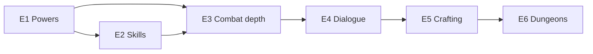

# UI Depth (Milestone E)

> **Position in the roadmap:** D → C → A → B → **E**.
> D, C, A and B are closed (see [`README.md`](README.md:11)), so this is not a tail of unfinished work:
> the game systems those milestones built are reachable from the browser and mostly *thin* once they
> arrive. E is the milestone that makes them legible.
> **Tracker:** no epic yet — this file is the specification; cards get created per phase after review.

## Status (2026-11-12)

| Phase | State |
|---|---|
| E1 powers and abilities | **shipped** — PR #65 |
| E2 skill sheet, `SkillXpGained` subscriber | **shipped** — PR #66 |
| E3 combat depth, shared fight snapshot | **shipped** — PR #67 |
| E4 NPC dialogue | **shipped** — schema, validator, both hub bridges and the panel; the conversations themselves are authored in Foundry ([`dialogue-depth.md`](dialogue-depth.md)) |
| E5 crafting on the real engine | **shipped** — [`CraftingOverlay.svelte`](../web/client/src/lib/game/CraftingOverlay.svelte) over the real recipe handler; `DefaultCraftingCost` is gone |
| E6 dungeons | **moved to [`dungeons.md`](dungeons.md)** — the model decided there; E6 is its client slice (F4) |

E1–E3 each turned out to need a server bridge as well as a panel: abilities shipped slugs instead of
content, `SkillXpGained` had no listener, and combat was broadcast to the caller alone. The pattern
that worked, twice, is worth stating: **resolve the content on the server into the snapshot, keep
the display rules in one pure client module, and delete the parity allow-list entry as the proof.**

---

## 1. The problem, stated precisely

The web client is not missing screens for missing systems. It has 43 of the 50 hub methods wired, 39
session state fields, 99.19% line coverage, and a parity suite that fails if a server capability has no
web consumer. What it does not have is **depth**: a wired action that renders a slug instead of a name is
technically parity and practically unfinished.

Three different kinds of gap hide behind the same word, and they cost very different amounts:

| Kind | Meaning | Example | Cost |
|---|---|---|---|
| **Stub surface** | The data is already on the wire or one query away; the UI renders the identifier | Abilities render `ability_slash` | Cheap, client-only |
| **Placeholder bridge** | The engine has a real system, the hub calls a stub instead | `CraftItem` charges a flat 50 gold and adds no item | Medium, server rewrite |
| **Absent feature** | Nothing anywhere reads the data the engine stores | NPC dialogue text, dungeon instances, skills | Expensive, needs design |

The milestone is ordered by that table, not by which feature sounds most exciting.

### What is actually thin, with evidence

| Surface | What the player sees today | Where |
|---|---|---|
| Abilities in combat | Six raw slugs, `ability.replaceAll('_', ' ')`, no cost or cooldown | [`CombatPanel.svelte`](../web/client/src/lib/game/CombatPanel.svelte:8) |
| Abilities out of combat | A list of slugs with one `Use` button each | [`GameOverlays.svelte`](../web/client/src/lib/game/GameOverlays.svelte) |
| The ability payload | `LearnedAbilities: string[]` — slugs only, deliberately | [`GameHub.cs`](../Veldrath.Server/Hubs/GameHub.cs:406) |
| Skills | Nothing. `SkillXpGained` is broadcast and no client subscribes | [`GameHub.cs`](../Veldrath.Server/Hubs/GameHub.cs:1190) |
| Combat | One enemy, four buttons, log capped at the last 12 lines; party participants invisible | [`CombatPanel.svelte`](../web/client/src/lib/game/CombatPanel.svelte) |
| Quests | `objective.key · 2/5` — the raw key, no prose | [`QuestTracker.svelte`](../web/client/src/lib/game/QuestTracker.svelte) |
| NPCs | `TalkToNpc` records a `talk:` quest objective and returns nothing | [`GameHub.cs`](../Veldrath.Server/Hubs/GameHub.cs:1411) |
| Crafting | Flat 50 gold, no recipe lookup, no ingredients, no item produced | [`CraftItemHubCommand.cs`](../Veldrath.Server/Features/Characters/CraftItemHubCommand.cs:43) |
| Dungeons | Validates the zone is a dungeon and returns its id | [`EnterDungeonHubCommand.cs`](../Veldrath.Server/Features/Characters/EnterDungeonHubCommand.cs:55) |

Two structural facts make every phase more expensive than it looks: [`GameOverlays.svelte`](../web/client/src/lib/game/GameOverlays.svelte)
is 735 lines holding six unrelated overlays, and [`session.svelte.ts`](../web/client/src/lib/game/session.svelte.ts)
is 1,182 lines holding every domain. Each phase splits the part it touches; there is no standalone
refactor phase, because a refactor with no behaviour change cannot be reviewed against a user story.

---

## 2. What "done" means — the seven rules every phase inherits

These are the definition of done at the milestone level. A phase is not done by satisfying its own
section alone; it must satisfy these too.

- **D1 — No identifier reaches the screen.** Every slug, key and enum renders as authored copy. If the
  content row is missing, say so loudly in the UI (`Unknown power: slash`) and log the miss; never print
  the raw value and never silently drop it.
- **D2 — Every action shows its cost and its consequence before it commits.** Mana, gold, ingredients,
  cooldown, level requirement: if the server would reject it, the control says why and is disabled with a
  reason, not silently inert.
- **D3 — State is server-authoritative and snapshot-first.** No client-side derivation of health, damage,
  rewards or outcomes. Mutations end in a snapshot broadcast, as Milestone C established for parties.
- **D4 — No new deferral.** A surface may remain unwired only with an entry in the parity allow-list that
  states a reason. Each phase **deletes** allow-list entries; none may add one.
- **D5 — Each phase removes structural debt in the code it touches** (an overlay out of `GameOverlays`,
  a domain out of `session.svelte.ts`), so the two monoliths shrink as features land.
- **D6 — Tests ship with the phase.** Web changes keep the Vitest gate green at 90% global with its
  per-glob floors and add cases for every new disabled state and error path. Server changes keep
  `scripts/check-dotnet-coverage.mjs` green and add handler tests.
- **D7 — The wire stays honest.** Any payload change updates
  [`types.ts`](../web/client/src/lib/game/types.ts) and survives
  [`payload-contract.test.ts`](../web/client/src/lib/game/payload-contract.test.ts); XML documentation
  (CS1591) applies to every new public type, per the repo rules.

---

## 3. The phases

### E1 — Powers and abilities, properly

**Goal.** A player can see what every ability does, what it costs, and why it is unavailable, and combat
buttons say so before the click.

**What exists today.** The `Power` content model is rich — `DisplayName`, `Description`, `School`,
`Tradition`, `EffectType`, `Cooldown`, `ManaCost`, `Range`, `Duration`, `Radius`, `MaxTargets`, `Tier`,
`RequiredLevel`, `Rank`, `BaseEffectValue`, `BaseDamage`, `DamageType`, `ConditionApplied`,
`Buff`/`Debuff` ([`Power.cs`](../RealmEngine.Shared/Models/Power.cs:10)). `GET /api/content/powers` and
`/api/content/powers/{slug}` already serve it ([`ContentEndpoints.cs`](../Veldrath.Server/Features/Content/ContentEndpoints.cs:70)),
and [`PowerCatalog`](../RealmEngine.Core/Features/PowerCatalog/) queries it. The client receives only
`LearnedAbilities: string[]`.

**Decision — extend the character snapshot, do not add a browser REST channel.** The browser has no REST
path to `Veldrath.Server`: `PUBLIC_API_URL` is read in server-only modules
([`game-request.ts`](../web/client/src/lib/server/game-request.ts:28)) and the only browser transport is
SignalR through `PUBLIC_HUB_URL`. Adding a browser REST channel would mean putting the game JWT in the
browser plus CORS work, to fetch data that must stay in lockstep with the fight. Instead, `SelectCharacter`
resolves the character's learned slugs into a compact `LearnedPowers` list — slug, display name,
description, school, mana cost, cooldown, damage band, damage type, effect type, required level — and the
payload carries it. `LearnedAbilities` stays during the transition and is removed once nothing reads it.

**Work.**

1. Server: resolve power definitions for the learned slugs in one query per selection; a slug with no
   content row logs a warning naming the slug and is returned as an unresolved entry so the UI can say so.
2. Payload: add `LearnedPowers` to `CharacterSelected`; update `types.ts`, the payload-contract test and
   the handler tests.
3. Client: a `PowerView` type and a `PowersOverlay.svelte` extracted out of `GameOverlays.svelte` (D5),
   listing every learned power with its detail; remove `slice(0, 6)`.
4. Combat: buttons show display name and mana cost, disabled with a reason when mana is short or the power
   is on cooldown, and the enemy's telegraphed abilities (`EnemyAbilityNames`, already sent in
   `CombatStarted`) render as text rather than being dropped.
5. Out-of-combat use (`UseAbility`) shares the same component and the same disabled reasons.

**Definition of done.**

- No raw slug appears anywhere in the abilities or combat surfaces.
- The abilities overlay no longer lives in `GameOverlays.svelte`, and the file is measurably smaller.
- A power that is unaffordable or cooling down is visibly unavailable **with its reason**, in and out of
  combat.
- All learned powers are reachable; nothing is capped at six.
- An unresolved slug renders as an explicit unknown entry and produces a server log line.

**Tests.** Server: selection payload includes the resolved powers; a missing content row is a warning, not
an exception. Web: the overlay, both disabled reasons, the unknown-power path, and the combat button state
matrix; payload-contract updated; coverage floors hold.

---

### E2 — The skill sheet

**Goal.** Skill progression becomes visible: XP moves a bar while you play, and a rank-up is announced.

**What exists today.** `AwardSkillXp` broadcasts `{ CharacterId, SkillId, TotalXp, CurrentRank, RankedUp }`
([`GameHub.cs`](../Veldrath.Server/Hubs/GameHub.cs:1190)) and the client does not listen — it is a
documented `NO_SUBSCRIBER` entry in [`hub-events.test.ts`](../web/client/src/lib/parity/hub-events.test.ts).
The engine has [`SkillCatalog`](../RealmEngine.Core/Features/SkillCatalog/),
[`Progression`](../RealmEngine.Core/Features/Progression/) and the `CharacterSkill` model; the character
summary (`CharacterDto`) carries no skills at all.

**Work.**

1. Server: include the character's skills in the `CharacterSelected` snapshot (slug, display name, category,
   total XP, rank, threshold for the next rank), resolved from the skill catalog the same way E1 resolves
   powers.
2. Client: subscribe to `SkillXpGained` — update the row in place, and toast `RankedUp`; a character with no
   skills shows an explanatory empty state rather than nothing.
3. A `SkillsOverlay.svelte` grouped by category with a progress bar per skill and the next-rank threshold.
4. Delete the `SkillXpGained` entry from the hub-events allow-list (D4).

**Definition of done.**

- Using an ability or completing an objective moves a visible bar without a refresh.
- A rank-up produces a notification naming the skill and the new rank.
- The skill sheet is reachable from the character sheet, not only from combat.
- The hub-events parity suite now fails if nothing subscribes to `SkillXpGained`.

**Tests.** Server: snapshot includes skills. Web: in-place update, the `RankedUp` toast, the empty state,
and the allow-list deletion enforced by the parity suite.

---

### E3 — Combat depth, party-aware

**Goal.** A fight between two players and one enemy is legible to both of them.

**What exists today.** Milestone C3 already tracks `SpawnedEnemy.Participants`,
`DamageContributions` and `LastAttackerId`, and splits rewards by contribution; the client renders one
enemy health bar, four buttons and twelve log lines and shows none of it.

**Work.**

1. Participants block: every participant's name, health, and contribution share, updated from
   `CombatTurn` and `CombatEnded` payloads.
2. A turn/initiative indicator, and a clear "waiting for the server" state so a player cannot double-submit.
3. Damage and healing feedback driven by server payload numbers, not client arithmetic (D3).
4. Log: the whole fight in a scroll region with a summary block — XP, gold, loot, and the per-participant
   split on victory; the death cost from Milestone A2 on defeat.
5. Reconnect: the resume path (`ResumeCombatIfAnyAsync`) must render the identical panel from the snapshot
   alone.

**Definition of done.**

- In a two-player fight each player sees the other's health, damage, and share of the reward.
- The panel never invents a number the server did not send.
- A disconnect during a fight re-renders correctly on resume.
- The combat panel is its own component tree, not one 98-line file that owns five concerns.

**Tests.** Web: participant rendering, turn state, victory summary with a split, defeat with the A2 cost,
and the resume path from a snapshot. Server: assert the `CombatTurn` / `CombatEnded` payloads carry what
the panel reads (a payload test, not a UI test, for the wire shape).

---

### E4 — NPC dialogue → **moved out of E** (content schema first)

**Goal.** Talking to an NPC shows authored prose and real options, and choosing one has a consequence.

**What exists today.** `TalkToNpc` advances a `talk:<npcSlug>` quest objective and returns nothing
([`GameHub.cs`](../Veldrath.Server/Hubs/GameHub.cs:1411)). Two gaps closed the phase before it opened:

1. **Dialogue is a line pool, not a node graph.** [`Dialogue`](../RealmEngine.Data/Entities/Content/Dialogue.cs:9)
   is a `ContentBase` whose payload is `Stats.Lines` — a `List<string>` — plus trait flags (`Greeting`,
   `Farewell`, `Merchant`, `QuestRelated`, `Hostile`, `Friendly`) and optional `Tone`/`Formality` indices.
   There are **no nodes, no options, no requirements and no consequences** in the model, so
   `ChooseDialogueOption` would have nothing to choose from.
2. **NPCs are not placed anywhere.** [`ActorInstance`](../RealmEngine.Data/Entities/Content/ActorInstance.cs:10)
   is a per-actor stat *override* of an `ActorArchetype`, with no zone or location field, and
   `LocationEntered` carries only `spawnedEnemies` ([`GameHub.cs`](../Veldrath.Server/Hubs/GameHub.cs:2216)).
   The client has no NPC to click: `TalkToNpc(npcSlug)` is callable, but nothing ever produces the slug.

**Consequence.** E4 is a content-schema phase with a panel at the end, not a UI phase:

- a placement model — NPCs attached to a zone location, exposed on `LocationEntered`, editable in Foundry;
- a dialogue structure — nodes with prose, options, a requirement per option and a consequence per option;
- then the panel described below, which is cheap once those two exist.

Deferred to the content milestone that follows E. Shipping a dialogue panel against a line pool would
produce a surface with no decisions in it — the exact failure mode this milestone exists to prevent.

> **Update 2026-11-19 — two of the three prerequisites shipped, so E4 moved.** NPC placement exists as
> its own row (`LocationNpc` + `LocationNpcsSeeder`, public/non-pool placement), and talking works:
> `TalkToNpc` verifies the person is standing with the character, answers with an authored greeting line
> and advances `talk:<slug>`. The stale facts above (an `ActorInstance` with no zone field, a client with
> no NPC to click) are history. What remains is the dialogue structure itself — prose, options, a
> requirement per option and a consequence per option — and then the panel, which is cheap. That work is
> specified in [`dialogue-depth.md`](dialogue-depth.md), including the one-shot rule that stops a
> gold-bearing option being farmed.

**Work (when the two prerequisites land).**

1. Server: a real `TalkToNpc` that resolves the NPC and returns its opening node — speaker display name,
   portrait or icon reference, prose, and options with their requirements and consequences. A new
   `ChooseDialogueOption` hub method applies the choice and returns the next node or closes the
   conversation. The `talk:` objective advancement stays, exactly as today, so nothing regresses.
2. Content: author dialogue for the NPCs that already exist in zones; a node with no authored dialogue
   says so in the UI rather than showing an empty panel.
3. Client: a dialogue panel with speaker, prose, options, and the consequence preview each option implies;
   options that cannot be taken are disabled with a reason (D2).
4. Remove `TalkToNpc` from the hub-methods allow-list (D4).

**Definition of done.**

- Talking to an authored NPC shows real text and at least two meaningful options.
- Choosing an option produces a server-confirmed, visible consequence.
- A player cannot reach a node the server would refuse; the server re-checks every option it is sent.
- `talk:` objectives still advance, proven by an existing test that must keep passing.

**Tests.** Server: node resolution, option validation, refusal of a stale or unknown option, objective
advancement preserved. Web: the dialogue panel, the disabled-option reason, the end-of-conversation state.

---

### E5 — Crafting and harvesting, on the real engine

**Goal.** Crafting consumes real ingredients and produces a real item, and the panel can explain why a
recipe is unavailable.

**What exists today — and this is the milestone's sharpest finding.** The hub's crafting is a
**placeholder**, not a thin view: [`CraftItemHubCommandHandler`](../Veldrath.Server/Features/Characters/CraftItemHubCommand.cs:66)
charges a flat `DefaultCraftingCost = 50` gold, never reads a recipe, never consumes an ingredient, never
adds anything to the bag, and returns `ItemCrafted = request.RecipeSlug`. Meanwhile the engine has a real
system that nothing calls: `CraftRecipeCommand/Handler`, `DiscoverRecipe`, `LearnRecipe`,
`GetKnownRecipes`, [`CraftingService`](../RealmEngine.Core/Features/Crafting/Services/CraftingService.cs),
plus [`RecipeCatalog`](../RealmEngine.Core/Features/RecipeCatalog/) and the `Recipe`/`CraftingStation`
models, with [`Harvesting`](../RealmEngine.Core/Features/Harvesting/) and `HarvestableNode` beside them.
Building a crafting UI on the current handler would ship a menu that takes money and produces nothing.

**Work.**

1. Server: replace the stub with a bridge to the engine's `CraftRecipeCommand` — ingredients checked against
   and removed from the inventory, station requirement enforced, skill/level requirement enforced, cost read
   from content rather than a constant, output item added to the bag, and `ItemCrafted` carrying the real
   item reference.
2. Server: a `GetKnownRecipes` read returning each recipe with its ingredients, resolved against the current
   bag so the client can render availability without guessing.
3. Harvesting: a hub path that reads the location's `HarvestableNode`s, rolls server-side, and reports what
   was gathered.
4. Client: a crafting overlay — recipe list, ingredient rows with have/need, station and level requirement,
   cost, and a disabled reason per unmet condition; a harvest action wherever the location shows
   harvestables.
5. Remove `CraftItem` from the hub-methods allow-list (D4) and drop the `ItemCrafted` entry from the
   no-subscriber list once it drives UI.

**Definition of done.**

- Crafting removes exactly the ingredients the recipe names and adds exactly the item it names.
- The bag, gold and the panel all update from the server's response; nothing is optimistically mutated.
- Every unavailable recipe states which condition failed.
- `DefaultCraftingCost` no longer exists in the codebase.
- A harvest produces an item in the bag and a log line naming the node.

**Tests.** Server: recipe satisfaction and rejection per condition (missing ingredient, wrong station,
insufficient skill, insufficient gold), and that a failed craft mutates nothing. Web: ingredient rows,
disabled reasons, and the post-craft refresh.

---

### E6 — Dungeons → **shipped as F4 of [`dungeons.md`](dungeons.md)**

**Goal.** Entering a dungeon is a place you go, with visible progress and a way out.

**What exists today.** `EnterDungeon` validates that the slug names a `ZoneType.Dungeon` zone and returns
its id, and does nothing else ([`EnterDungeonHubCommand.cs`](../Veldrath.Server/Features/Characters/EnterDungeonHubCommand.cs:55)).
The `DungeonInstance` model exists but nothing creates one.

**Why it moved.** The decision this phase was blocked on turned out to be much larger than a UI question,
and the investigation found that **five dungeons are already authored as zones with interior maps** — plus
four content defects that make three of them inescapable and one of them half-unreachable. The model
decisions were taken on 2026-11-12 and recorded in [`dungeons.md`](dungeons.md): dungeons stay authored
zone maps, a `ZoneLocation` may open into an interior map of rooms, and locations may be **public or
instanced per location** with progress scoped to match.

E6 is therefore the **client slice** of that plan (phase F4 there): dungeon framing, the room list from
the map graph with the current room marked, progress, an always-available exit, and the soft level
warning. Everything before it — the entry path, the instance lifecycle, cleared state and unlock keys —
is server and content work that this phase cannot skip, which is why it now lives in its own plan rather
than as a bullet here.

---

## 4. Order and dependencies



The chain is deliberate:

- E1 before everything: it establishes the pattern for content resolution in a payload, which E2 copies.
- E2 before E3: combat wants skill bars for the abilities that train them, and E2 proves the
  in-place-update path E3 needs for participants.
- E4 before E5: crafting needs a station that belongs to an NPC or location, which is exactly what E4
  establishes.
- E5 before E6: dungeon rewards flow through the item and crafting path E5 fixes.
- E1 and E2 are client-heavy and can ship in a week of small PRs; E4, E5 and E6 each carry a server
  bridge and should not share a PR with anything else.

---

## 5. Explicitly out of scope

Recorded so nobody assumes they were forgotten, and so the milestone stays finishable:

- **Latency display** (`Ping` has no UI) and **multi-client character status**
  (`GetActiveCharacters`) — both are diagnostics; the roster is server-rendered and there is no latency
  budget to display yet.
- **Engine systems with no surface at all**, which are E7 material rather than E: enchanting, socketing,
  salvaging, upgrading, reputation/factions, achievements, victory conditions, and the item-generation
  catalogs. The engine has [`Enchanting`](../RealmEngine.Core/Features/Enchanting/),
  [`Socketing`](../RealmEngine.Core/Features/Socketing/), [`Salvaging`](../RealmEngine.Core/Features/Salvaging/),
  [`Upgrading`](../RealmEngine.Core/Features/Upgrading/), [`Reputation`](../RealmEngine.Core/Features/Reputation/)
  and [`Achievement`](../RealmEngine.Core/Features/Achievement/) features; the web client shows none of them.
- **Guilds, trading, duels, auction house** — carried over from Milestone C's deferral list, still deferred.
- **A standalone `GameOverlays` / `session.svelte.ts` refactor.** Both shrink inside the phases that touch
  them (D5) rather than in a PR nobody can review.
- **A power codex or content browser for players.** Fun, but the Foundry already browses content and E1 only
  needs the character's own powers.

---

## 6. Verification

Every phase must leave all of these green before it is considered done:

```bash
# Server-side changes
dotnet build Realm.Full.slnx --configuration Release
dotnet test Realm.Full.slnx --configuration Release --no-build \
  --collect "XPlat Code Coverage" --settings coverage.runsettings --results-directory ./TestResults
bash scripts/coverage-report.sh "-reports:./TestResults/*/coverage.cobertura.xml" \
  "-targetdir:./CoverageReport" "-reporttypes:Html;Cobertura;MarkdownSummaryGithub;TextSummary"
node scripts/check-dotnet-coverage.mjs --report ./CoverageReport/Cobertura.xml \
  --floors scripts/coverage-floors.json --suggest

# Web changes, from web/
npm run typecheck && npm run lint && npm run test && npm run coverage --workspace client
```

The parity suites are the milestone's own scoreboard: [`hub-methods.test.ts`](../web/client/src/lib/parity/hub-methods.test.ts),
[`hub-events.test.ts`](../web/client/src/lib/parity/hub-events.test.ts),
[`rest-routes.test.ts`](../web/client/src/lib/parity/rest-routes.test.ts),
[`content-schema.test.ts`](../web/client/src/lib/parity/content-schema.test.ts) and
[`routes.test.ts`](../web/client/src/lib/parity/routes.test.ts). A phase that starts from a deferral must
end with that deferral deleted from the allow-list — that, and not a screenshot, is the proof it shipped.

---

## 7. Risks

| Risk | Why it matters | Mitigation |
|---|---|---|
| E5 turns into an inventory rewrite | Ingredients, stations and outputs touch `IInventoryService`, the bag rows and the shop | Land the server bridge first behind the existing `CraftItem` method name, so the UI can be built against a working handler |
| E6 scope creep | "Dungeon" can mean instances, timers, lockouts and matchmaking | Force the zone-vs-instance decision in writing before code; ship the map-graph version first |
| Payload growth | `CharacterSelected` gets bigger with powers and skills | One query per selection, a compact DTO per entity, and a payload-contract test that fails on drift |
| Two monoliths get worse | Every overlay added to `GameOverlays` makes the next one harder | D5: the touched overlay moves out in the same PR |
| Coverage erosion on the server | New hub bridges are long methods with many branches | Handler tests per rejection path; the .NET gate is a no-regression ratchet, not a target |

---

## 8. Findings after E1–E3 (2026-11-12)

Recorded as they were discovered, because each one changed what a phase actually is.

**E1 and E2 both needed a server bridge, not just a panel.** Abilities reached the client as a slug
array; skills were a storage-key convention nobody read back and a broadcast nobody listened to.
Both shipped as *resolve on the server into the snapshot, decide in one pure client module, delete the
allow-list entry*, and that is now the pattern to copy.

**E3 was mostly a server phase.** Combat turns, rewards and enemy health all went to `Clients.Caller`,
so two players in one fight could not see each other at all. The fix was a shared snapshot broadcast to
the zone (`CombatParticipants`) with no rewards in it, and a panel drawn from it. The lesson: when a
panel looks thin, check who the server is talking to before rewriting the markup.

**E4 is not a UI phase.** `Dialogue` is a *line pool* — `Stats.Lines` plus trait flags — with no nodes,
options, requirements or consequences, and nothing places an NPC in a location (`ActorInstance` is a
stat override with no zone field, and `LocationEntered` carries only enemies). A dialogue panel built on
that would have no decisions in it. E4 therefore moves to the content milestone, behind two schema
items: NPC placement exposed on `LocationEntered`, and dialogue nodes with per-option requirements and
consequences. The panel becomes cheap afterwards.

**E5 is a design decision, not a swap.** `CraftRecipeCommand` does not take ids: it takes a hydrated
engine `Character`, a `Recipe` and a `CraftingStation`, and its `CraftingService` depends on
`RecipeDataService` — a catalog loader — while the server is DB-first. So the bridge needs
(a) hydrating an engine `Character` from the entity, attributes and inventory, (b) loading the `Recipe`
and station from content, (c) persisting the results: ingredients removed, item added, skill XP awarded,
gold spent. Each of those is a decision worth writing down before code, and the stub being replaced
(`DefaultCraftingCost = 50`, no ingredient check, no item produced) makes the temptation to keep it
cheap quite strong.

**E6 still needs its decision made in writing** before anything else: dungeon as a small map reached
through the graph, or an instanced lifecycle with its own reset semantics. The recommendation stands —
ship the map-graph version first.
